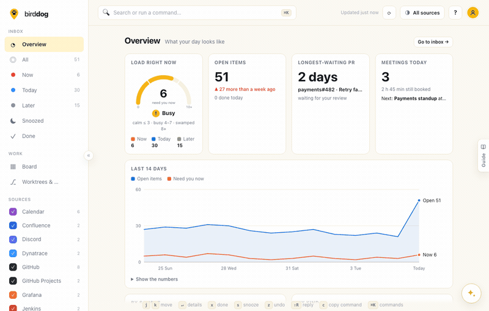

# 🐾 Birddog

[](https://www.npmjs.com/package/@marcusferrell/birddog)
[](https://nodejs.org)
[](LICENSE)
[](https://github.com/marcsalot/birddog/actions/workflows/ci.yml)
[](package.json)

**[Try the live demo →](https://marcsalot.github.io/birddog/app/)** (made-up data, runs in your browser) · [Website](https://marcsalot.github.io/birddog/)

**What needs me next?** Birddog is a local-first inbox for developers. It looks through your local git repos, GitHub, Jira and calendar, ranks what it finds with plain rules, and tells you *why* each thing is there.



```bash
npx @marcusferrell/birddog --demo --open  # look around with made-up data (http://127.0.0.1:4848)
npx @marcusferrell/birddog --open         # the real thing (http://127.0.0.1:4747)
```

You need Node 22 or newer. There's no account and no cloud, and the package has no dependencies. See [Install](#install) for `npm i -g`, Docker and running from source.

## Why

Work-in-progress hides in too many places: a branch you forgot to push, a review someone is waiting on, a Jira ticket due tomorrow, a meeting in ten minutes. Each tool has its own inbox and its own idea of "important". Birddog puts them in one list and is upfront about its reasoning:

> **@ana-lopez** requested your review **2 days** ago · they are waiting on you
> *Rule: Review requested of you over a day ago → Now*

- **Explains itself.** Every item has a "why" line and names the rule that put it there. There are no scores and no machine learning, just a list of rules you can read in [`src/rules.mjs`](src/rules.mjs).
- **Local-first.** It runs on your machine, listens only on `127.0.0.1`, and keeps its state in JSON files you can read. There's no telemetry.
- **Read-only.** It never pushes, comments, moves tickets, RSVPs, or marks notifications as read. Done and snooze only change Birddog's own list.
- **Keyboard-first.** `j`/`k` to move, `x` done, `s` snooze, `z` undo, `⌘K` for everything else.
- **Zero runtime dependencies.** It's plain Node and browser JavaScript. Even the iCalendar parser and the MCP server are hand-written.
- **Talks to your AI tools.** `birddog mcp` lets Claude Code, Claude Desktop or any MCP client ask "what needs me?" and triage items.

## Install

**1. With npm** (recommended; needs [Node.js](https://nodejs.org) 22 or newer):

```bash
npx @marcusferrell/birddog --open       # run it straight away, nothing installed
```

```bash
npm install -g @marcusferrell/birddog    # or install it for good …
birddog --open                            # … then run it as birddog
```

The npm package is `@marcusferrell/birddog` (the plain name `birddog` is taken); the command is `birddog` either way. Upgrade with `npm install -g @marcusferrell/birddog@latest`.

**2. With Docker**: no Node needed. See [Run it in Docker](#run-it-in-docker).

**3. From source** (no `npm install` step, because there are no dependencies):

```bash
git clone https://github.com/marcsalot/birddog && cd birddog
node bin/birddog.mjs --open
```

### First run

The first time you open Birddog it asks one thing: **where do you keep your code?** It has already looked in the usual places (`~/code`, `~/src`, `~/projects`, `~/Developer`, …, and the folder you ran it from), counted the repos in each, and ticked the ones that have some. Usually you just press **Show my work**, and the inbox fills with your uncommitted work, unpushed commits and branches to tidy. You don't need an account for any of this.

Then Birddog suggests one next step above the list: **Connect GitHub** (one click with your `gh` login). Until you do, GitHub stays switched off, so a fresh inbox has no "not signed in" warnings. Everything else (Jira, Linear, Slack, calendars and the rest) waits in **Sources & settings** and the guide; "Not now" hides the suggestion for good. Prefer a tour of every source? `⌘K` → "Run the setup wizard".

With login turned on, you see the same screen after your first sign-in. From a clean config folder on the development Mac, it takes **one click and about half a second** from starting `birddog` to the first items (median of 3 runs: 0.3 s to the first-run screen, then 0.25 s from the click to the list).

```
birddog                 start on http://127.0.0.1:4747
birddog --open          start and open your browser
birddog --demo          made-up data in a temporary folder on :4848; your real setup is never touched
birddog mcp             MCP server on stdio (add --demo for made-up data)
birddog notify          desktop notifications without the dashboard (--on, --test)
birddog --port 5000     use another port
birddog --host 0.0.0.0  listen beyond localhost (only with login turned on; also BIRDDOG_HOST)
birddog secret set jira-token   store a secret in your keychain (hidden prompt, or pipe it in; also cal-url, caldav-password, anthropic-api-key, google-client-secret, atlassian-client-secret, apple-private-key, oidc-client-secret)
birddog --version
birddog --help
```

If the port is busy, Birddog tries the next one. If Birddog is already running, `birddog --open` just opens the existing one.

### Demo mode

`birddog --demo` starts Birddog with an imaginary company's repos, PRs, tickets and meetings. It uses a fresh temporary folder, an in-memory secret store and a fake network layer. Your repos, tokens and calendar are never read, nothing goes over the network, and everything is deleted when you stop it. The real GitHub, Jira and Calendar sources run against fake APIs, so the ranking and "why" lines are exactly what real data would produce. The GIF above was recorded this way.

## Run it in Docker

If you'd rather not install Node, or you want Birddog running all the time on a home server, use the image. It's built from this repo on `node:22-alpine` with `git` added, runs as a non-root user, and contains only what the npm package ships.

```bash
git clone https://github.com/marcsalot/birddog && cd birddog
docker build -t birddog:local .
docker run --rm -p 127.0.0.1:4848:4747 birddog:local --demo --port 4747   # made-up data: open http://127.0.0.1:4848
```

The real thing, with your config and triage state on a volume and your code mounted **read-only**:

```bash
docker run -d --name birddog --restart unless-stopped \
  -p 127.0.0.1:4747:4747 \
  -v birddog-data:/data \
  -v ~/code:/repos:ro \
  -e TZ=Europe/Berlin \
  -e GITHUB_TOKEN \
  birddog:local
```

Or with Compose, which does the same and also has a demo service:

```bash
GITHUB_TOKEN=$(gh auth token) docker compose up -d     # http://127.0.0.1:4747
docker compose --profile demo up birddog-demo          # http://127.0.0.1:4848, no mounts, no tokens
```

Compose reads these from your shell (or a `.env` file next to `docker-compose.yml`, which you keep out of git):

| Variable | Default | What it does |
|---|---|---|
| `BIRDDOG_REPOS` | `~/code` | The folder holding your git repos, mounted read-only at `/repos`. Set it if your code lives elsewhere. |
| `TZ` | `UTC` | Your time zone, e.g. `America/Chicago`, so meeting times and "today" match your clock. |
| `BIRDDOG_PORT` | `4747` | Host port for the dashboard (always on `127.0.0.1`). |
| `BIRDDOG_DEMO_PORT` | `4848` | Host port for the demo service. |
| `GITHUB_TOKEN`, `BIRDDOG_JIRA_TOKEN`, `BIRDDOG_CAL_URL` | unset | Tokens for the sources you use. See the table below. |

For example, with your repos in `~/Projects`:

```bash
BIRDDOG_REPOS=~/Projects TZ=America/Chicago GITHUB_TOKEN=$(gh auth token) docker compose up -d
```

If `BIRDDOG_REPOS` points to a folder that doesn't exist, Docker creates an empty one and Birddog finds no repos. Check the path if setup shows nothing under `/repos`.

> ⚠️ **Publish the port on `127.0.0.1` only**, as every example here does. Inside the container Birddog listens on `0.0.0.0`, because that's the only way Docker can forward to it, and it trusts Docker to keep the port on your loopback. `-p 4747:4747` or `-p 0.0.0.0:4747:4747` would let anyone on your network read your work inbox: PR titles, ticket names, meetings. To reach it from other machines, put it behind [login](#login-for-the-dashboard-sso) and a reverse proxy with HTTPS.

**How the container differs from running it directly**

| | Directly | In Docker |
|---|---|---|
| Listens on | `127.0.0.1` (change with `--host` or `BIRDDOG_HOST`) | `0.0.0.0` inside, published to host loopback |
| Config and state | `~/.config/birddog` | the `/data` volume (`birddog-data`): survives restarts and rebuilds |
| Your repos | any folder | whatever you mount, read-only; scan `/repos` (the default on first run) |
| Secrets | OS keychain | **environment variables or Docker secret files only**: never written to `/data` |
| GitHub sign-in | `gh` CLI or device flow | `GITHUB_TOKEN` |
| Time zone | your machine's | set `TZ`, or meeting times show in UTC |

`BIRDDOG_CONTAINER=1` (set in the image) switches all of this on. Birddog never guesses whether it runs in Docker.

**Tokens in a container.** A container has no keychain, so Birddog reads secrets from the environment and refuses to keep them in a plain-text file on the volume. Setup shows where each one comes from (never its value) and what to set if it's missing:

| Secret | Variable | Or a file (Docker secret) |
|---|---|---|
| GitHub token | `GITHUB_TOKEN` (or `GH_TOKEN`) | `GITHUB_TOKEN_FILE=/run/secrets/github` |
| Jira API token | `BIRDDOG_JIRA_TOKEN` | `BIRDDOG_JIRA_TOKEN_FILE` |
| Calendar iCal link | `BIRDDOG_CAL_URL` | `BIRDDOG_CAL_URL_FILE` |
| Anthropic API key (Ask Fetch) | `ANTHROPIC_API_KEY` | `ANTHROPIC_API_KEY_FILE` |
| OIDC client secret (login) | `BIRDDOG_OIDC_CLIENT_SECRET` | `BIRDDOG_OIDC_CLIENT_SECRET_FILE` |
| Session signing key (login) | `BIRDDOG_SESSION_KEY` | `BIRDDOG_SESSION_KEY_FILE` |

The Jira site and email, the repo folders and everything else are set in setup as usual and saved on the volume. Pass tokens with `-e NAME` (the value comes from your shell, not the command line), with an `--env-file` you keep out of git, or as files under `/run/secrets`; `docker-compose.yml` shows the secrets version. To try the env-variable mode outside Docker, set `BIRDDOG_SECRETS=env`.

**MCP through Docker.** Stdio works through `docker run -i`. Share the dashboard's volume so both see the same items and triage:

```bash
claude mcp add birddog -- docker run -i --rm -v birddog-data:/data -v ~/code:/repos:ro birddog:local mcp
```

```json
{
  "mcpServers": {
    "birddog": {
      "command": "docker",
      "args": ["run", "-i", "--rm", "-v", "birddog-data:/data", "-v", "/Users/you/code:/repos:ro", "birddog:local", "mcp"]
    }
  }
}
```

Leave out `-p`; the MCP server doesn't listen on a port. It reads what the dashboard container last collected. If that's older than two refresh intervals, it refreshes itself, and then it needs the same tokens (add `-e GITHUB_TOKEN`, or `-v ~/.secrets/github:/run/secrets/github:ro -e GITHUB_TOKEN_FILE=/run/secrets/github`). Claude Desktop needs the full path to `docker` if it isn't on its `PATH`.

## Sources

| Source | What it finds | How it connects |
|---|---|---|
| **Local git** | Unpushed commits, uncommitted work, merged and stale branches | Scans folders you pick; runs read-only `git` commands |
| **GitHub** | Review requests, your PRs with failing checks, change requests or conflicts, unread @mentions, assigned issues | Your existing `gh` login, or "Sign in with GitHub" (device flow) |
| **Jira Cloud** | Your tickets: overdue, sprint ending, blocked, high priority | Site + email + API token |
| **Calendar** | Meetings starting soon or later today, all-day events, from **every calendar you connect, in one list** | Sign in with Google and/or Microsoft, iCloud (app-specific password), Thunderbird's calendars on this computer, and any iCal link or `.ics` file |
| **GitLab** | MRs to review, your MRs with failed pipelines or conflicts, assigned issues | Sign in with GitLab, or a `read_api` token |
| **Linear** | Your issues: overdue, cycle ending, blocked, urgent | Personal API key |
| **Azure DevOps** | PRs you haven't voted on, work items assigned to you | Sign in with Azure DevOps (Microsoft Entra, read-only `vso.code` + `vso.work`), or a PAT with Work Items: Read, Code: Read |
| **Sentry** | New and regressed errors assigned to you | Auth token with `event:read`, `org:read` |
| **PagerDuty** | Incidents paged to you (**Now**), your on-call shifts | User API token |
| **Slack** | Mentions, and DMs waiting for your reply. Can reply, opt-in | User token with `search:read`, `im:read`, `im:history`, `users:read`; `chat:write` to reply. Fastest setup: create the app from [docs/slack-app-manifest.json](docs/slack-app-manifest.json) |
| **Microsoft Teams** | 1:1 chats waiting for your reply, @mentions in group and meeting chats. Can reply, opt-in | Sign in with Microsoft Teams (work or school account): `Chat.Read`; `ChatMessage.Send` to reply. Channel posts aren't read (that needs an admin-only permission) |
| **Discord** | @mentions of you (or a role you have) in your servers that you haven't answered in that channel since | A bot you create and invite (Discord gives personal apps no access to your own account). Bot token + your user ID; never sees your DMs |
| **Thunderbird** | Unread mail from the last week, and starred mail you haven't replied to | Reads Thunderbird's own mail files on this computer, read-only. No account, no token |
| **Microsoft To Do** | Tasks overdue, due within a week, or important. **Two-way**, opt-in | Sign in with Microsoft To Do: `Tasks.Read`; `Tasks.ReadWrite` once you turn on Sync done |
| **Google Tasks** | Tasks (Gmail's and Calendar's Tasks panel) overdue or due within a week. **Two-way**, opt-in | Sign in with Google Tasks: `tasks.readonly`; `tasks` once you turn on Sync done |
| **Todoist** | Tasks overdue, due within a week, or priority 1. **Two-way**, opt-in | API token |
| **Dynatrace** | Open problems in your management zone: availability and errors are **Now** | API token with `problems.read`; SaaS or Managed |
| **Grafana** | Alerts firing now (not silenced), critical ones **Now** | Service account token (Viewer); Grafana Cloud or a **private** Grafana |
| **Jenkins** | Jobs whose last build failed or is unstable, in a view or folder (optionally only builds you broke or started) | Username + API token; works with a **private** Jenkins |
| **GitHub Projects** | Project items assigned to you that aren't done, ranked by iteration end, due date and priority | Your GitHub sign-in, with `read:project` |
| **Confluence** | Pages and comments that mention you, and tasks assigned to you | Site + email + API token (same kind as Jira's) |
| **Gmail** | Unread and starred mail, **sorted into needs-you, FYI and noise** | Sign in with Gmail: `gmail.metadata` (headers and labels, never bodies) |
| **Outlook mail** | Unread and flagged mail, **sorted into needs-you, FYI and noise**, using Focused Inbox | Sign in with Outlook mail: `Mail.ReadBasic` (never bodies) |

GitHub also reports **failing Actions runs** on branches you pushed this week, and **Dependabot alerts** on those repos (`"actions": false` / `"security": false` under `sources.github` turn them off).

When a source fails, its last good items stay in the list, marked stale, with a **Retry** button. One broken token never empties your inbox. Details for each source are [further down](#what-it-finds-local-git).

## Privacy and secrets

- Everything stays on your machine: config, cache and triage state live in `~/.config/birddog/` as plain JSON.
- Tokens and private calendar links go to your **OS keychain** (macOS Keychain, or Secret Service on Linux), never into config files, never into API responses, and never to the browser. If no keychain is available, Birddog says so clearly before falling back to a file only you can read. See [Secrets](#secrets).
- Birddog only talks to the services you connect, and to nothing else. It reads with `GET` requests. The one exception is a **reply** you send yourself (Slack, see [Reply from Birddog](#reply-from-birddog)): off until you turn on **Allow replies**, and it posts as you only when you press Send.
- For a shared machine, you can put the dashboard behind your own OpenID Connect login (Google, Okta, Entra, …). See [Login](#login-for-the-dashboard-sso).
- In [Docker](#run-it-in-docker), tokens come only from environment variables or Docker secrets and are never written to the volume. Your repos are mounted read-only, and the port is published to `127.0.0.1` only.

## Use it from Claude (MCP)

`birddog mcp` runs a [Model Context Protocol](https://modelcontextprotocol.io) server over stdio. It reads the same data as the dashboard, so both can run at once, and decisions made in one show up in the other.

**Claude Code:**

```bash
claude mcp add birddog -- npx -y @marcusferrell/birddog mcp
```

**Claude Desktop:** add this to `claude_desktop_config.json` (Settings → Developer → Edit Config), then restart Claude Desktop:

```json
{
  "mcpServers": {
    "birddog": {
      "command": "npx",
      "args": ["-y", "@marcusferrell/birddog", "mcp"]
    }
  }
}
```

Claude Desktop starts servers with a short `PATH`. If it can't find `npx`, use the full path (`which npx`). If you use the GitHub CLI login, add `"env": { "PATH": "/opt/homebrew/bin:/usr/bin:/bin" }` so Birddog can find `gh`.

Want to try it first? Use `["-y", "@marcusferrell/birddog", "mcp", "--demo"]` and it runs on made-up data.

| Tool | What it does |
|---|---|
| `list_items` | What needs you, most urgent first, each with its "why". Filter by `urgency`, `source`, `status`; `limit`. |
| `get_item` | One item in full: rule, fields, link, suggested next step. |
| `list_sources` | Which sources are connected, item counts, and which are stale (with the error). |
| `mark_done` | Done in Birddog until the item changes. |
| `snooze` | Hide until `1h`, `3h`, `2d`, `tomorrow`, `next-week`, `change`, or a date. |
| `restore` | Undo a done or snooze. |
| `reply` | **Off by default.** Post a reply as you (Slack DMs and mentions). Listed only with `"mcp": { "allowReplies": true }` in config.json *and* "Allow replies" on the Slack card. |

The tools return titles, "why" lines, links and fields, never tokens, secrets or settings. Triage tools only change Birddog's own list. If the dashboard hasn't refreshed recently, the MCP server refreshes the sources itself.

> **`reply` is outward-facing.** With it on, an AI agent can post real messages that other people read, under your name, without the dashboard's 5-second undo. Birddog posts exactly the `text` in the tool call, as plain text (an agent can't trigger `@channel` or `@here`), and only to the DM or thread of an item in your inbox. Turn it on only for agents you trust to ask you first.

## How it works

```
 sources (git, GitHub, Jira, iCal)        each returns Items: title, why, urgency, url, fields
        │   plain rules rank them          src/rules.mjs: first match wins, the rule is shown
        ▼
 collector ── cache.json                  keeps the last good result per source; stale + backoff on failure
        │
 triage ──── state.json                   done / snooze, comes back when the item changes
        │
        ├── HTTP server + UI               127.0.0.1 only, strict CSP, no build step (public/)
        └── MCP server (stdio)             birddog mcp
 secrets ─── OS keychain                  tokens and private links, never in files or responses
```

Each source is one small ES module with `test()` and `collect()`. Adding one is about a page of code; see [Writing a source](#writing-a-source). The whole thing is about 5,700 lines of JavaScript with 164 `node:test` tests, and none of the tests touch the network. CI runs them on Node 22 and 24 and inside the Docker image.

## What it finds (local git)

Birddog scans the folders you choose (3 levels deep, skipping `node_modules`, `vendor`, `dist` and friends) and reports:

| Item | Example "why" | Suggested next step (copy with `c`) |
|---|---|---|
| Unpushed commits | **3 commits** only on this machine for **5 days** · push to back them up | `git -C ~/code/api push -u origin feat/x` |
| Uncommitted changes | Edits sitting uncommitted for **4 days** · commit or stash before they get lost | `git -C ~/code/api status` |
| Merged branches | Already merged into **main** · safe to delete | `git -C ~/code/api branch -d old-a old-b` |
| Stale branches | No commits in **3 months** · finish, rebase or delete | `git -C ~/code/api branch -vv` |

It is read-only: it never fetches, commits, pushes or deletes. It only runs `git status`, `for-each-ref`, `log`, `branch --merged`, `symbolic-ref` and `remote`, each with a timeout and with `GIT_OPTIONAL_LOCKS=0` so it never fights your editor for the index lock.

## What it finds (GitHub)

Sign in once in **Connect a source** (see [Sign in with GitHub](#sign-in-with-github)) and Birddog shows:

| Item | Example "why" | Suggested next step |
|---|---|---|
| Review requests | **@ana** requested your review **2 days** ago · they are waiting on you | `gh pr checkout 12 -R acme/api` |
| Your PRs with changes requested | **@ben** requested changes **1 day** ago · address the feedback | `gh pr view 20 -R acme/api --comments` |
| Your PRs with failing checks | **2 checks failing**: test, lint · fix before reviewers look | `gh pr checks 20 -R acme/api` |
| Your PRs with merge conflicts | **Merge conflicts** with **main** · merge or rebase to unblock it | |
| Unread @mentions (last 14 days) | **@dee** mentioned you **5 hours** ago | `gh issue view 30 -R acme/api --comments` |
| Issues assigned to you | Milestone **v2.1** is due **tomorrow** · assigned to you | `gh issue view 40 -R acme/api` |

How it decides:

- **Review requests** come from the search `is:open is:pr review-requested:@me`. The PR's events say who asked and when. Requests made of a team you are on, and drafts, rank lower than requests made of you.
- **Your PRs** come from `is:open is:pr author:@me`. A PR shows up only when something needs you: a reviewer whose latest verdict is "changes requested", a failing check run or commit status, or merge conflicts. Clean PRs stay out of your way.
- **Mentions** come from your unread GitHub notifications with reason `mention` or `team_mention`. If the latest comment on the thread is yours, you already answered, so it is skipped. Birddog never marks notifications as read.
- **Assigned issues** rank higher when their milestone is due within 3 days (or overdue), or when they carry a label like `P0`, `P1`, `urgent`, `critical`, `blocker` or `priority: high`.
- If one PR or issue shows up for two reasons (say, assigned *and* mentioned), you see it once, under the more urgent one.
- Each search shows the 50 most recently updated results. A refresh costs 3 searches, one notifications call and a few calls per PR, well inside GitHub's rate limits.

Not signed in? The GitHub source shows as stale with a "Sign in to GitHub in setup" link. GitHub Enterprise works too: set `webUrl` and `apiUrl` under `sources.github`.

## What it finds (Jira Cloud)

The open tickets assigned to you (`assignee = currentUser() AND statusCategory != Done`), ranked:

| Example "why" | Urgency |
|---|---|
| **Overdue** · was due **2 days ago** and is still In Progress | Now |
| Sprint **Sprint 42** ends **today** · still In Progress | Now |
| **Blocked** by PAY-12 · chase it or pick up something else | Today |
| Due **in 2 days** · In Review | Today |
| **Highest** priority · To Do | Today |
| **In Progress** · last updated **10 days** ago | Later |

"Blocked" means an *is blocked by* link to a ticket that is not done, the **Flagged** field, or a status named like *Blocked* or *On hold*. Sprint deadlines come from the active sprint on the ticket. Want a different set of tickets? Put your own JQL in config.json as `sources.jira.jql`.

### Connect Jira

1. Create an API token at [id.atlassian.com → Security → API tokens](https://id.atlassian.com/manage-profile/security/api-tokens) (**Create API token**, the plain kind without scopes).
2. In Birddog, open **Connect a source** → **Jira Cloud**, enter your site (`acme` or `acme.atlassian.net`), your Atlassian email and the token, then **Test & connect**.

Birddog tests the settings before it saves anything. The token goes to your OS keychain (see [Secrets](#secrets)); config.json only gets the site and email. **Disconnect** deletes the token and switches the source off. Jira is off until you connect it, so people without Jira never see it complain.

Why an API token and not Atlassian OAuth? OAuth would mean registering your own app in the Atlassian developer console and keeping a client secret, which is a lot more setup than one token for a tool that runs on your machine.

## What it finds (Calendar)

Your meetings from every calendar you connect, **read together into one list**: Google (sign-in), Outlook / Microsoft 365 (sign-in), iCloud (CalDAV), Thunderbird's calendars on this computer, and any iCal link or `.ics` file. Connect as many as you like; the Calendar card lists each one with its own **Remove** button and an **Add a calendar** button. A meeting that's in two calendars (invited at work and at home) shows once, naming both. If one calendar fails, the rest still show and the card says which one broke.

**Thunderbird's calendars** are its local calendars plus the offline copies it keeps of Google, CalDAV and iCal calendars you subscribed to in Thunderbird. Birddog copies Thunderbird's calendar file (`calendar-data/local.sqlite`) to a temporary folder and reads the copy with Node's built-in SQLite (Node 22.13 or newer), so it never locks or changes Thunderbird's file. Disabled calendars are skipped.

Example lines:

| Example "why" | Urgency |
|---|---|
| Starts **in 10 minutes** · Google Meet | Now |
| **Happening now** · started 5 minutes ago, ends at 10:30 | Now |
| Starts at **14:00** (in 3 hours) · Room 4 | Today |
| **All day** today | Later |
| Tomorrow at **09:30** · Zoom | Later |

Open the item (`o`) to join: Birddog picks the Zoom, Meet, Teams or Webex link out of the event. Finished meetings disappear; cancelled ones never show up. Add your email in setup and meetings you declined are hidden too.

### Connect a calendar

Paste the private iCal address of your calendar into **Connect a source** → **Calendar**, then **Test & connect**:

- **Google Calendar:** Settings → your calendar → Integrate calendar → *Secret address in iCal format*.
- **Outlook / Microsoft 365:** Settings → Calendar → Shared calendars → Publish a calendar → the *ICS* link.
- **iCloud:** share a calendar as a *Public Calendar* and copy the link (`webcal://` links are fine).

That link works like a password (anyone who has it can read your calendar), so Birddog keeps it in your OS keychain as `cal-url`, never in config.json, and never shows it in the UI, the API or error messages (only its host name). You can also point at a local `.ics` file instead, or as well.

The reader is built in (no dependencies) and handles what real feeds contain: folded lines and escapes, UTC, `TZID` and floating times, Windows zone names from Outlook, all-day and multi-day events, `DURATION`, recurring events (`RRULE` with `DAILY`/`WEEKLY`/`MONTHLY`/`YEARLY`, `INTERVAL`, `COUNT`, `UNTIL`, `BYDAY` such as `2TU` or `-1FR`, `BYMONTHDAY`, `BYMONTH`), `EXDATE`, `RDATE`, and single instances that were moved or cancelled (`RECURRENCE-ID`). Recurring events keep their wall-clock time across daylight saving changes. A zone it doesn't know falls back to the zone's standard offset, with a warning in setup. Not supported: `BYSETPOS`, `HOURLY`/`MINUTELY` rules and `BYWEEKNO` (such events show their first occurrence only).

## Email: what needs you vs noise

Thunderbird, Gmail and Outlook mail don't just list unread mail. Each message gets a verdict, and the item says why:

| Verdict | When | Where it goes |
|---|---|---|
| **Needs you** | from someone on your *Always important* list; your provider flagged it (Gmail's Important, Outlook's Focused); it says *urgent*, *action required*, *please approve*…; it's from someone you've replied to before; or a person sent it to you directly | Today (Later after 3 days) |
| **FYI** | you're only on CC, it came through a list or BCC, or Outlook put it in Other | Later |
| **Noise** | newsletters and mailings (an unsubscribe link, `List-Id`, `Precedence: bulk`, `Auto-Submitted`), no-reply and other robot senders, Gmail's Promotions / Social / Forums, notification mail from tools Birddog already shows (GitHub, Jira, Slack, Sentry…), senders you muted, and mail you sent | not listed; the card counts it ("12 noise skipped") |

Starred / flagged mail always counts as needing you. A robot that says *action required* still gets through. Each mail card has **Always important** and **Always noise** (addresses or `@domains`), and **Also list the noise** if you'd rather see it, in Later.

### Reading an email: in Birddog, or in your mail app

Choose where emails open (in an email's details, or ⌘K → *Open emails in…*):

- **Birddog** (the default): the message opens in the details panel, as plain text. HTML mail is turned into text and never rendered, so no images or tracking pixels load and nothing in an email can run in the page. Long messages are cut at 20,000 characters, with a note.
- **Web app**: Gmail or Outlook on the web, at that message.
- **Apple Mail**: a `message://` link with the email's Message-ID.

If your choice can't open a particular email (a Thunderbird message has no web link, say), it opens in Birddog instead. <kbd>o</kbd> and the panel's main button follow the choice; *Read it here instead* is always there.

Thunderbird messages are read from Thunderbird's own file. Gmail and Outlook need one more permission to show message text: set **Read message text** to *yes* on the Gmail or Outlook mail card and sign in again. Gmail then uses `gmail.readonly` instead of `gmail.metadata` (Gmail won't hand out bodies while the metadata scope is granted), and Outlook adds `Mail.Read`. Until then, the panel says so and links to the message in its app.

Without *Read message text*, Gmail asks for `gmail.metadata` and Outlook for `Mail.ReadBasic`: senders, subjects, labels and flags, never what an email says. Neither can change anything. `gmail.metadata` is a Google *restricted* scope, so Sign in with Gmail works for the Birddog Google app's test users until that app passes Google's verification; bring your own Google app to use it right away.

## Ops and work tools

**Dynatrace** reads open problems (`GET /api/v2/problems`, status open). Problems aren't assigned to people, so set a **management zone** or an **entity selector**, or you'll see the whole environment. Availability and error problems are **Now**; slowdowns and resource problems are Today, then Later after 3 days. SaaS (`https://abc12345.live.dynatrace.com`) and Managed (`https://host/e/<environment-id>`) both work.

**Grafana** reads alerts that are firing, not silenced and not inhibited, from Grafana Alerting's Alertmanager API. A `severity` (or `priority`) label of *critical*, *page*, *p1* or *sev1* makes it **Now**. Narrow it with a label filter like `team=payments, env!=dev`.

**Jenkins** reads one view or folder (`…/view/payments` or `…/job/payments`) in one request, including multibranch pipelines (one item per failing branch), and lists jobs whose last finished build failed or is unstable. **Only mine** keeps the builds you started or that list you among the culprits.

**Private servers.** Birddog runs on your computer, so it reaches whatever your computer can: your office network or VPN. Grafana, Jenkins and Dynatrace Managed accept `http://` only for hosts on your own network (`localhost`, `10.x`, `172.16–31.x`, `192.168.x`, Tailscale's `100.64–127.x`, single-label names and `.local`, `.lan`, `.internal`, `.corp`, `.home.arpa`), so a token never crosses the internet in the clear. If your servers use certificates from your company's own CA, start Birddog with `NODE_EXTRA_CA_CERTS=/path/to/company-ca.pem`. When you're off the VPN, the source says so and keeps its last good items.

**GitHub Projects** reads the boards you list (`https://github.com/orgs/ORG/projects/N` or `/users/NAME/projects/N`) through your GitHub sign-in, which needs the `read:project` scope: Birddog's own GitHub sign-in asks for it; with the `gh` CLI run `gh auth refresh -s read:project`. Items assigned to you that aren't done are ranked like tickets: the *Status* field, an *Iteration* ending, a *Due* / *Target* / *Deadline* date field, a *Priority* field, and a blocked status.

**Confluence** reads pages and comments that @mention you in the last 7 days (CQL `mention = currentUser()`, skipping your own edits) and inline tasks assigned to you that aren't done (by due date). One Atlassian API token works for both Jira and Confluence.

## Task lists, two-way

**Microsoft To Do**, **Google Tasks** and **Todoist** list your open tasks that are overdue, due within a week, or marked important / priority 1 (**Show all** in config, `"showAll": true`, lists every open task). Overdue, due today and important are **Today**; the rest are **Later**.

They sync both ways, if you want:

- **Reading** is always on. Complete a task in To Do, Google Tasks or Todoist and it leaves Birddog on the next refresh.
- **Sync done** is a switch on each task source's card, off by default. With it on, marking a task **Done** in Birddog (the button, <kbd>x</kbd>, or MCP `mark_done`) completes it in the app, and **Undo** / **Restore** reopens it. If the app refuses, nothing changes in Birddog and you see why. Snooze stays in Birddog.
- To Do and Google Tasks ask for write access (`Tasks.ReadWrite`, `tasks`) only at the sign-in after you switch Sync done on. Todoist tokens can't be limited to reading, so Birddog only writes when the switch is on.
- A recurring Todoist task moves to its next date when closed (as it does in Todoist), and Undo reopens it.

Thunderbird's own tasks and Apple Reminders aren't read yet: Thunderbird keeps tasks in the same calendar file (writing it back isn't safe while Thunderbird runs), and Reminders has no web API.

## Profiles: Work, Home and your own

The **profile** button in the top bar (or <kbd>⇧P</kbd>) picks which sources you see. Birddog starts with two:

| Profile | Shows | When (in Auto) |
|---|---|---|
| **Work** | every source | Monday–Friday, 08:00–18:00 |
| **Home** | local git, GitHub, calendar, Discord, Thunderbird, Google Tasks, Todoist | the rest of the time |

**Auto** (the default) switches by schedule: the first profile whose schedule covers right now, otherwise the first one without a schedule. You can also pin a profile, or pick **All sources**. **Edit profiles** lets you rename them, pick their sources, set days and hours (overnight windows like 22:00–06:00 work), turn notifications off for a profile, and add up to 12 (On call, Side project, Weekend…).

Every source keeps refreshing in the background, so switching is instant. A profile changes three things: the inbox (and its counts and charts), which items can notify you (items outside the profile are noted silently, so switching later never causes a burst), and what `list_items` returns over MCP (pass `profile: "all"` or a `source` to look past it). Profiles live in `config.json` under `"profiles"`; which one is showing is a preference in `state.json`.

```json
"profiles": [
  { "id": "work", "name": "Work", "sources": null, "schedule": { "days": [1, 2, 3, 4, 5], "from": "08:00", "to": "18:00" }, "notify": true },
  { "id": "home", "name": "Home", "sources": ["git", "github", "cal", "discord", "thunderbird", "gtasks", "todoist"], "schedule": null, "notify": true }
]
```

`"sources": null` means every source. Days run 0 = Sunday to 6 = Saturday.

Until you pick a profile, Birddog uses **Auto**. Set `BIRDDOG_PROFILE` (`all`, `auto` or a profile id like `work`) to start somewhere else: handy for a container or an MCP setup that should always see everything. Once you pick one in the app, your choice wins.

## More sources

Sources & settings lists every source A–Z, with a search box that matches names and kinds of thing (*calendar* finds Google, Microsoft, iCloud and iCal; *ci* finds GitHub Actions, GitLab pipelines and Azure).

GitLab, Linear, Azure DevOps, Sentry, PagerDuty, Slack, Discord and Thunderbird are off until you connect them in **Sources & settings**. Each card asks for the smallest read-only access that works and shows a link to where you make that token. Tokens go to your keychain as `gitlab-token`, `linear-token`, `azure-devops-token`, `sentry-token`, `pagerduty-token`, `slack-token`, `discord-token`, `todoist-token`, `dynatrace-token`, `grafana-token`, `jenkins-token` and `confluence-token`; in Docker, use `GITLAB_TOKEN`, `LINEAR_API_KEY`, `AZURE_DEVOPS_EXT_PAT`, `SENTRY_AUTH_TOKEN`, `BIRDDOG_PAGERDUTY_TOKEN`, `BIRDDOG_SLACK_TOKEN`, `BIRDDOG_DISCORD_TOKEN`, `TODOIST_API_TOKEN`, `BIRDDOG_DYNATRACE_TOKEN`, `BIRDDOG_GRAFANA_TOKEN`, `BIRDDOG_JENKINS_TOKEN` and `BIRDDOG_CONFLUENCE_TOKEN`. Thunderbird needs no token. None of them write anything while collecting. The only non-GET requests are read-only queries that the API takes as POST: Linear's GraphQL queries (never mutations) and Azure's WIQL. Slack can also post your replies, only once you turn on [Allow replies](#reply-from-birddog).

| Source | Ranks it as | Rules that fire |
|---|---|---|
| GitLab | review requests, your PRs, issues | the same rules as GitHub |
| Linear, Azure Boards | tickets | the same rules as Jira (overdue, cycle/sprint end, blocked, priority) |
| Azure Repos | review requests | the same rules as GitHub (unvoted only) |
| Sentry | errors | regressed or new → Today; others → Later |
| PagerDuty | incidents, on call | triggered → **Now**; acknowledged and on call now → Today; shift soon → Later |
| Slack | mentions, DMs | fresh → Today; older → Later |
| Discord | mentions | under 3 days → Today; older → Later |
| Thunderbird | email | starred and not replied, or unread under a day → Today; older unread → Later |
| To Do, Google Tasks, Todoist, Confluence tasks | tasks | overdue, due today, or important / P1 → Today; due within a week → Later |
| Dynatrace, Grafana | alerts | critical (outage, error, `severity=critical`) → **Now**; others → Today, then Later after 3 days |
| Jenkins | CI failures | failed or unstable under 2 days → Today; older → Later |
| GitHub Projects | tickets | the same rules as Jira |
| Confluence | mentions | under 3 days → Today; older → Later |
| Gmail, Outlook mail, Thunderbird | email | starred, or needs you → Today; FYI → Later; noise hidden |
| GitHub Actions / Dependabot | CI failures, security alerts | failing < 2 days and critical/high → Today; others → Later |

GitLab also has **Sign in with GitLab**: register an application under *User settings → Applications* (scope `read_api`, *not* confidential, redirect `http://127.0.0.1:4747/auth/oauth/gitlab/callback`), then set `"oauth": { "gitlab": { "clientId": "…", "url": "https://gitlab.com" } }`.

### Discord

Discord doesn't let personal apps read your own account (user tokens are against its terms), so Birddog reads through a bot you own:

1. [discord.com/developers/applications](https://discord.com/developers/applications) → **New Application** → **Bot** → **Reset Token**, and copy the token.
2. On the same page, switch on **Message Content Intent**, or message text comes back blank.
3. **OAuth2 → URL Generator**: scope `bot`, permissions **View Channels** and **Read Message History**. Open the URL and add the bot to each server you want watched.
4. In Discord, turn on **Developer Mode** (Settings → Advanced), right-click your name and **Copy User ID**.

Birddog checks the 40 most recently active text channels and threads in each server for the last 7 days. A mention counts when it names you, replies to you, or names a role you have. It drops off once you post in that channel after it. The bot sees only the channels you let it into, and never your DMs. It only reads.

### Thunderbird

Birddog finds Thunderbird's default profile (`~/Library/Thunderbird` on macOS, `~/.thunderbird` on Linux, including the Snap and Flatpak folders, and `%APPDATA%\Thunderbird` on Windows). It reads the newest 8 MB of each account's Inbox and the read, starred, replied and deleted flags Thunderbird writes into every message. It opens the files read-only: mark a message read or unstar it in Thunderbird and it leaves the list. IMAP accounts are covered when Thunderbird keeps mail on this computer, which it does by default. Set **Profile folder** if yours is elsewhere. Maildir stores aren't read yet. In Docker there's no Thunderbird to read unless you mount the profile.

Not built yet: Bitbucket Cloud. Its "PRs waiting for my review" needs a query per repository, and I'd rather not guess at its newer API-token scheme without a way to test it.

## Sign in instead of pasting tokens

Where a card shows **Sign in with …**, it's one click: Birddog uses **its own public app** for that provider, so you don't register anything. Every sign-in is the OAuth 2.0 authorization code flow with **PKCE** (or GitHub's device flow), with the redirect coming back to this Birddog on `127.0.0.1`. None of them needs a secret Birddog would have to hide. The line next to each button says what Birddog will read.

| Card | Sign-in | What Birddog gets | Built-in app? |
|---|---|---|---|
| GitHub | device flow, or **Use my gh CLI login** | `repo read:org` (GitHub has no read-only repo scope; Birddog only reads) | yes, github.com |
| Calendar | **Sign in with Google** (desktop app + PKCE) | `calendar.readonly` | yes |
| Calendar | **Sign in with Microsoft** (public client, work and personal accounts) | `Calendars.Read`, `User.Read` | yes |
| GitLab | **Sign in with GitLab** (PKCE, no secret) | `read_api` | yes, gitlab.com |
| Linear | **Sign in with Linear** (PKCE, no secret) | `read` | yes |
| PagerDuty | **Sign in with PagerDuty** (Classic User OAuth, PKCE, no secret) | `read` | yes |
| Jira Cloud | API token; advanced: your own Atlassian app | `read:jira-work`, `read:jira-user` | no: Atlassian needs a confidential secret |
| Slack | user token (`xoxp-…`) | read-only scopes, plus `chat:write` to reply | no: Slack needs a confidential secret |
| Microsoft Teams | **Sign in with Microsoft Teams** (the Microsoft app above, its own sign-in) | `Chat.Read`, `User.Read`; `ChatMessage.Send` only after you turn on Allow replies | yes, with the Microsoft app |
| Calendar | **iCloud** (CalDAV with an app-specific password) | your iCloud calendars, read-only | n/a |

> **About Google sign-in.** Birddog's Google app is **in testing** for now, so sign-in is **invite-only**: Google only admits accounts the maintainer added as test users, and everyone else gets "access denied" or "has not completed verification" (Birddog turns both into this advice). Use your calendar's private **iCal link** instead, which needs no Google sign-in. Test users see Google's **"unverified app"** screen (choose **Continue**, or **Advanced → Go to Birddog (unsafe)**), and Google ends test sign-ins after **7 days**, so expect **Sign in again** weekly. Birddog only reads your calendar events, read-only, and they stay on your computer.
>
> The Calendar card shows the matching notice next to the button. It's driven by `BUILT_IN.google.status` in `src/auth/clients.mjs`: `'testing'` (invite-only, weekly sign-in), `'unverified'` (published: anyone can sign in through the warning screen, 100 accounts in all) or `'verified'` (no notice).
>
> **The Google app secret.** Google's token exchange also needs the desktop client's secret, and Birddog doesn't ship it (not in the code, config defaults or docs). Until you have it, the Calendar card shows one step instead of a button: get the secret from whoever runs the Birddog Google project, then run `birddog secret set google-client-secret` and paste it at the hidden prompt (it's kept in your keychain, and never passes through the command line or shell history). Or set `BIRDDOG_GOOGLE_CLIENT_SECRET` / `BIRDDOG_GOOGLE_CLIENT_SECRET_FILE` and restart. Maintainers: see [docs/register-apps.md](docs/register-apps.md#giving-someone-the-google-secret).

After you sign in, the card shows the account and **Disconnect**. If a sign-in can't be renewed later (you revoked it, or PagerDuty's 30-day token ran out), the source turns stale with a **Sign in again** button.

**Which app is used**: `BIRDDOG_<PROVIDER>_CLIENT_ID` first, then `oauth.<provider>.clientId` in config.json (`sources.github.clientId` for GitHub), then Birddog's built-in one ([src/auth/clients.mjs](src/auth/clients.mjs)). The built-in apps only cover each provider's main cloud. GitHub Enterprise and self-managed GitLab need your own app, and so does any copy of Birddog built without the built-in IDs. In that case the card says so and offers the token instead. Maintainers: [docs/register-apps.md](docs/register-apps.md) is the checklist for registering the built-in apps, and [PRIVACY.md](PRIVACY.md) is the privacy policy they point to.

**Bring your own app** (optional, for the providers above or for Atlassian). Put the client ID in config.json, or in an environment variable, and restart:

```json
{ "oauth": { "google": { "clientId": "1234-abc.apps.googleusercontent.com" },
             "microsoft": { "clientId": "00000000-0000-0000-0000-000000000000", "tenant": "common" },
             "atlassian": { "clientId": "AbCdEf123" } } }
```

(`BIRDDOG_GOOGLE_CLIENT_ID`, `BIRDDOG_MICROSOFT_CLIENT_ID`, `BIRDDOG_ATLASSIAN_CLIENT_ID` and so on work too.) A secret for your own app goes in the keychain (`birddog secret set <provider>-client-secret`) and is only ever used with your own client ID. Tokens and refresh tokens go to your keychain as `oauth-<provider>`, never to a file. They are renewed automatically before they expire (several providers rotate refresh tokens; Birddog keeps the new one).

**Disconnect** forgets them and switches off the source that used them. It also revokes them at Google, GitLab and Linear. Microsoft, Atlassian and PagerDuty have no per-token revoke, so to remove Birddog's access entirely, use account.microsoft.com → *Privacy → App access*, id.atlassian.com → *Connected apps*, or PagerDuty's app settings.

**Registering your own app**

- **Google Calendar.** In the [Google Cloud console](https://console.cloud.google.com/apis/credentials):
  1. Create a project, and enable the **Google Calendar API**.
  2. Set up the OAuth consent screen. Keep it in *Testing* and add yourself as a test user.
  3. Go to **Create credentials → OAuth client ID → Desktop app**. Desktop clients accept loopback redirects, so there's nothing else to register.
  4. If Google shows a client secret (it isn't confidential for desktop apps), save it with `pbpaste | birddog secret set google-client-secret`.
- **Microsoft 365 / Outlook.** In [Microsoft Entra → App registrations → New registration](https://entra.microsoft.com/#view/Microsoft_AAD_RegisteredApps/ApplicationsListBlade):
  1. Choose the account types you need. *Personal + work* means tenant `common`.
  2. Under **Authentication**, add the platform **Mobile and desktop applications** and allow public client flows.
  3. Add the redirect URI `http://127.0.0.1/auth/oauth/microsoft/callback`. Microsoft ignores the port for loopback URIs; if the portal refuses `http://127.0.0.1`, add it in the app manifest under `replyUrlsWithType`.
  4. Under **API permissions**, add the delegated `Calendars.Read`. There's no client secret: it's a public client.
- **Atlassian (Jira Cloud).** In the [developer console](https://developer.atlassian.com/console/myapps/):
  1. Create an **OAuth 2.0 integration**.
  2. Under *Permissions*, add the **Jira API** scopes `read:jira-work` and `read:jira-user`.
  3. Under *Authorization*, set the callback URL to `http://127.0.0.1:4747/auth/oauth/atlassian/callback`, using your Birddog port.
  4. Atlassian's token exchange needs the client secret, so store it with `pbpaste | birddog secret set atlassian-client-secret`.
  5. After you sign in, Birddog finds your Jira site and calls it through `api.atlassian.com`. Links still open on your own site.
- **iCloud.** Apple has no OAuth for calendars. Go to [appleid.apple.com](https://appleid.apple.com/account/manage) → **Sign-In and Security → App-Specific Passwords** and make a password just for Birddog. On the Calendar card, choose **iCloud** and enter your Apple ID and that password; it goes to your keychain as `caldav-password`. Never use your real Apple ID password. Birddog reads your calendars over CalDAV (`caldav.icloud.com`, read-only `PROPFIND`/`REPORT`), and never sends the password anywhere but iCloud.

Sign-ins aren't available in Docker, because there's no keychain there to hold the tokens. Use API tokens and iCal links (`BIRDDOG_JIRA_TOKEN`, `BIRDDOG_CAL_URL`) instead.

## When a source breaks

Birddog never empties your inbox because one source failed. If GitHub is down, your token expired or a calendar link moved:

- The source's last good items stay in the list, each marked **⚠ stale since 10:48**.
- A bar above the list names the source, says how old its data is, shows the error, and has **Retry** (try now) and **Fix** (open setup).
- The sidebar marks the source **! stale**; hover it for the next automatic try.
- Automatic refreshes back off for a source that keeps failing: 2, 4, 8, 16, 32 minutes, then hourly. Refreshing by hand (`r`) or pressing **Retry** always tries right away. The other sources keep refreshing on schedule.
- The last good data is kept in `cache.json`, so it survives a restart.

## How ranking works

Rules live in [`src/rules.mjs`](src/rules.mjs). They are checked top to bottom and the first match wins. Order also breaks ties inside a group: people waiting on you come first, then deadlines, then local git hygiene.

| Source | Rule | Urgency |
|---|---|---|
| Calendar | Meeting in progress or starting within 15 minutes | **Now** |
| GitHub | Review requested of you over a day ago | **Now** |
| GitHub | Assigned issue in a milestone that is past due | **Now** |
| Jira | Ticket past its due date | **Now** |
| Jira | Sprint ends within a day and the ticket is not done | **Now** |
| Calendar | Meeting later today | Today |
| GitHub | Fresh review request for you | Today |
| GitHub | Your PR has changes requested | Today |
| GitHub | Your PR has failing checks | Today |
| GitHub | Your PR has merge conflicts | Today |
| GitHub | Assigned issue in a milestone due within 3 days | Today |
| GitHub | Assigned issue labeled urgent, critical, P0 or P1 | Today |
| GitHub | Unread @mention from the last 3 days | Today |
| Jira | Ticket is blocked or flagged | Today |
| Jira | Ticket due within 3 days | Today |
| Jira | Sprint ends within 3 days and the ticket is not done | Today |
| Jira | High, Highest, Critical or Blocker priority | Today |
| Calendar | All-day event today | Later |
| Calendar | Meeting tomorrow | Later |
| GitHub | Review requested of your team, or on a draft | Later |
| GitHub | Your draft PR has failing checks, conflicts or change requests | Later |
| GitHub | Older unread @mention | Later |
| GitHub | Other open issues assigned to you | Later |
| Jira | Other open tickets assigned to you | Later |
| git | Unpushed commits older than 3 days | **Now** |
| git | Unpushed commits older than 1 day | Today |
| git | Fresh unpushed commits | Later |
| git | Uncommitted edits older than 3 days | Today |
| git | Recent uncommitted edits | Later |
| git | Only untracked files | Later |
| git | Local branches already merged | Later |
| git | Unmerged branches with no commits for 30 days (or remote branch deleted) | Later |

Inside a group, items sort by rule order, then oldest first (the work that has waited longest is most at risk). A branch counts as either stale *or* unpushed, never both, and repos with no remote are never nagged about pushing.

## Main menu

The menu on the left holds everything:

- **Overview**
- the **inbox** views (All, Now, Today, Later, Snoozed, Done)
- **Work**: the ticket **Board** (`b`) and **Worktrees & slots** (`w`)
- your **sources** (click one to hide or show its items)
- **Ask Fetch**, the **Guide**, and **Sources & settings**

Collapse it to icons with « or `m`. Counts stay visible as small badges (Now in red), and every icon keeps its name as a tooltip and for screen readers. Birddog remembers which way you left it. On a phone it becomes a drawer behind ☰. It fits beside the guide rail: with both open, the page in the middle keeps at least ~640px on wide screens, and on narrower ones the guide floats over the page instead.

## User guide

Press `g`, click the **Guide** tab on the right edge, or pick it from the **?** help menu at the top right, for the **guide**, a searchable rail on the right that you can widen (`⇧G`) or drag to any width: getting started, sources, triage, shortcuts, notifications, chat, Docker and MCP. On wide screens it docks beside the page; on narrower ones it floats over it. It remembers whether you left it open, and `⌘K` → *Guide: …* jumps to a section.

The top right has three things: the **profile** switcher, **?** for help (the guide, keyboard shortcuts, the setup wizard, what's new, the README, the live demo, and where to report a problem), and the avatar for the **account menu** (who you're signed in as, or "just you, on this computer", Preferences, Sources & settings, and Sign out when login is on).

**Preferences** (`,`, or the account menu) puts everything that's yours to choose in one window: **Appearance** (theme, light or dark), **Notifications**, **Profiles**, **Email** (where emails open), **Layout** (menu expanded, guide open at start, the next-step card, hidden sources) and **About** (version, where your data lives). Each change saves as you make it.

Its screenshots come from `npm run screenshots`, a [Playwright](https://playwright.dev) script that starts Birddog in `--demo` mode (made-up data only) and captures light and dark versions into `public/guide/`. Playwright is a **devDependency**; the published package still has no runtime dependencies. It needs a Chromium: `npx playwright install chromium`, or point `BIRDDOG_CHROMIUM` at one.

## Launch slots

Run several copies of your app at once, one per git worktree, each in its own **slot** (a set of ports plus a lock file), so they never collide and everyone can see what's running:

```bash
birddog slot start --worktree PROJ-123   # claim the first free slot, build, start, wait until ready
birddog slot status                      # every slot: ports, who holds it, free or busy
birddog slot restart --service web       # restart one service in the slot you hold
birddog slot stop                        # stop yours (the checkout you're in by default)
birddog slot cleanup                     # stop every slot the locks record (--ports: also orphans on slot ports)
```

Settings go in `launch-site.json` at the top of your repo (commit it; every worktree finds it through the main checkout):

```json
{
  "worktreeRoot": "..",
  "slots": [
    { "name": "dev1", "ports": { "api": 5010, "web": 5173 } },
    { "name": "dev2", "ports": { "api": 5012, "web": 5174 } }
  ],
  "build": [{ "cwd": ".", "command": "npm ci" }],
  "services": {
    "api": { "cwd": "api", "command": "npm start", "env": { "PORT": "{api}" }, "timeoutSec": 120 },
    "web": { "cwd": "web", "command": "npm run dev -- --port {web} --strictPort", "env": { "API_URL": "http://localhost:{api}" } }
  }
}
```

`{api}`, `{web}` (any port name), `{slot}`, `{worktree}` and `{worktree_path}` are filled in per slot. Each service waits on the port named by its `port` field (default: its own name).

Optional sections, each skipped when absent:

| Key | What it does |
|---|---|
| `require` | files that must exist in the worktree before anything is claimed |
| `guards` | `{ "file", "pattern", "message" }`: stop before claiming when a local file contains a pattern (say a hard-coded port). Guards only read. |
| `overlays` | `{ "file", "body" }`: per-slot files written into the worktree (say `web/.env.local` with `PORT={web}`). A file of yours already there is backed up and restored when the slot stops; tracked files are refused; both stay out of `git status` via `.git/info/exclude`. |
| `build` | commands run before the services start |
| `after` | commands run once the slot is live (codegen and the like); a failure is reported, the slot stays up |
| `"ownerCheck": "port"` (per service) | accept whoever listens on the port, for a listener outside the service's own processes (a Docker-published port). Stop then takes that listener down too. |

How it stays safe with several people or agents launching at once:

- A slot is free only with **no lock and none of its ports answering**. Claiming creates the lock exclusively, so two launches can't both win.
- Services start together and are polled together. One that exits before opening its port fails at once, with the end of its log. A port answered by a process the launch didn't start fails as `FOREIGN_LISTENER` instead of passing for ready.
- Each recorded pid carries its process start time, so a pid the OS has since given to another program is never taken for ours, and never killed.
- Anything that fails releases the claim (before launch) or stops what was started. Stop kills only the process trees the lock records, checks the ports went quiet, and only then releases the lock. A port held by something else is reported, never killed.
- Locks are `key=value` lines (`worktree`, `worktree_path`, `slot`, `status`, `<service>_pid`, `ports`, `timestamp`, `heartbeat`) in `lockDir` (default: the worktree root); logs are in `lockDir/.launch-site/logs/`. A lock with nothing running, or `starting` for longer than `staleStartingSec` (300), is cleared on the next start.

**Worktrees & slots** reads the same file and locks: its dev slots become your launch slots (Running, Starting, Stale lock), and each worktree that isn't running gets **Start in a slot**, which copies the command. Locks written by other launch scripts in the same `key=value` format show up too.

### The launch-site skill for Claude Code

```bash
birddog skill install launch-site
```

This copies the skill to `~/.claude/skills/launch-site` (`--project` puts it in this repo's `.claude/skills` instead). Then say *"launch the site for PROJ-123"*, *"restart the API"*, *"what slots are running?"* or *"stop the site"*. Claude runs `birddog slot` for you, explains failures from the logs, and never kills processes itself. In a repo without `launch-site.json`, it offers to draft one from what it finds (`package.json`, `.csproj`, `go.mod`) and writes it only after you agree.

## Ticket board

**Board** (`b`) shows your Jira tickets in delivery swimlanes:

**In Progress → In Code Review → Code Review Pass → Ready for Deployment**

Each card has the ticket, how long it has sat in its status (from the Jira changelog; ⏳ after 3 days), type, priority and fix version, and where the work lives: its **worktree** (with uncommitted changes), the **dev slot** running it, and the **QA slot** it is deployed to or claimed on. A ticket with no worktree yet gets **Copy "new worktree"**, a `git worktree add` command for you to run.

**Lanes & filter** edits the board:

- **Whose tickets:** assigned to you (default), everyone's in some projects, or your own JQL.
- **Lanes:** name, Jira statuses (each lane takes several, since teams name them differently, e.g. *Code Review* / *PR Code Review*), order. Up to 8 lanes. A status can be in one lane only. **Reset to defaults** brings back the four above.

It needs the Jira source connected. It's read-only: one search per minute at most, and Birddog never moves a ticket. Settings live in `config.json → board`.

## Worktrees & slots

**Worktrees & slots** (`w`) is where each ticket is being worked on, run and tested:

- **Dev slots**: the places you run the app on this machine, each with its own ports. A slot is **Running** when something listens on its ports, or when its **lock file** names a live process. You can also **Claim** a slot for a worktree and ticket by hand, with a note. A lock file whose processes have gone shows **Stale lock**.
- **QA slots**: numbered shared test environments (say QA 1 to QA 12). Give an address pattern like `https://qa{n}.example.com` and a **version path** (like `/api/version`) and Birddog asks each one, at most once a minute, which branch, commit and build it runs, and finds the ticket in the branch name. **Claim** notes who has a slot, for which ticket. Claims are notes on your machine (`slots.json`), not a lock your team sees.
- **Worktrees**: every `git worktree` of your repos: branch, ticket and its board lane, uncommitted changes, unpushed commits, ahead/behind the main branch, last commit and dev slot, with flags like *Ready for deployment, but has uncommitted changes*, *41 commits behind main* or *no commit in 19 days*. Buttons copy `code …`, `cd …` and `git worktree remove …`; Birddog only reads your repos.

With no repos set, it lists every repo that uses worktrees in your git scan folders. **Set up slots** changes everything:

```json
"workspace": {
  "repos": ["~/code/myapp"],
  "ticketPattern": "(PROJ|OPS)-\\d+",
  "branchPrefix": "feature/",
  "devSlots": [
    { "label": "Dev 1", "ports": [5173, 5001], "lockFile": "~/code/.dev1.lock" },
    { "label": "Dev 2", "ports": [5174, 5003] }
  ],
  "qa": { "count": 12, "pattern": "https://qa{n}.example.com", "versionPath": "/api/version", "label": "QA {n}" }
}
```

A **lock file** is whatever your launch scripts write: `key=value` lines or JSON. Birddog reads `worktree` (or `path`, `cwd`), `branch`, `ticket`, any `pid` / `*_pid`, and `heartbeat` (or `updated`, `started`). The **version reply** can name things its own way: `branch` / `gitBranch` / `sourceBranch`, `gitSha` / `sha` / `commit`, `buildId` / `buildNumber` / `version`, also nested under `git` or `build`.

## Overview

Birddog opens on an **Overview**: one look at what your day is like. The inbox is a click away (or `1`; `0` comes back).

- **Load right now:** a dial for how many items need you now, labeled **Calm** (≤ 3), **Busy** (4–7) or **Swamped** (8+), with an icon and the word, never color alone.
- **Open items**, compared with a week ago, plus how many you finished today.
- **Longest-waiting PR:** the review request or PR of yours that has waited longest.
- **Meetings today:** how many are left, how much time is still booked, and what's next.
- **Last 14 days:** open items and Now items per day, from a small local history (`history.json`, one row per day, kept for 60 days).
- **By source** (stacked by Now / Today / Later) and **by kind**.
- **Source health**, with Retry on anything stale.

The charts are plain SVG drawn by Birddog (no chart library). Hover, or move to a mark with the keyboard, to see its numbers; every chart also has **Show the numbers** with the same data as a table. Chart colors are a colorblind-checked set (orange = Now, blue = Today and open items, aqua = Later), stepped separately for light and dark, so they read the same in all three palettes.

## Ask Fetch (chat)

Press the **✦** button in the bottom-right corner (or `a`) to ask **Fetch**, Birddog's assistant (the dog that fetches answers), about your inbox in plain words: *What needs me now? What's blocking me? Anything due tomorrow? Which of my PRs need work?* Fetch answers from your own items and can mark things done or snooze them.

- **Off until you turn it on.** It needs your own [Anthropic API key](https://console.anthropic.com/settings/keys), and you have to tick **"I understand that inbox content is sent to Anthropic"** first. To answer, Fetch sends your question and the items it looks up (titles, "why" lines, fields, links) to Anthropic's API. Nothing is sent before you turn it on. **Turn off** forgets the key.
- **Your key stays in your keychain** (`anthropic-api-key`), or in `ANTHROPIC_API_KEY` in Docker. It never goes into config.json, API responses or logs.
- **It reads every source you've connected.** The model uses Birddog's own MCP tools: `list_items` (any source, filtered by source, urgency, status or words with `query`), `get_item` and `list_sources`, and the panel shows which ones ran. Tool inputs are checked against their schemas before anything runs.
- **It asks before it changes anything.** `mark_done`, `snooze` and `restore` stop the answer and show a **Confirm / Cancel** card. Only Birddog's own list changes, never GitHub, Jira or git.
- **It can draft a reply, never send one on its own.** Once Slack has **Allow replies** on, ask *"reply to Priya that I'm free at 3"*: Fetch drafts it, and the card shows the **full text** and where it goes, with **Confirm and send / Cancel**. Nothing posts until you confirm.
- **Memory.** Say *"remember that Priya is my manager"* and Fetch keeps a short note; new conversations start with your notes. The **Memory** tab lists them, each with **Forget** (or **Forget everything**). Notes that look like a password, key or token are refused. Conversations are saved too, so a reload or restart picks up where you left off; **＋** starts a new one. Both stay on this computer (`memory.json` and `chat-history.json` in Birddog's folder, mode 600), and conversations are dropped after a week.
- **Boundaries you can see.** The **Boundaries** tab lists what Fetch can read (your connected sources), what it can do, what needs your confirmation, and what it never does: see tokens or settings, change GitHub/Jira/git, send without you, reply where replies are off, browse the web, follow instructions written inside your items, or keep secrets. Birddog enforces these, not just the prompt: when Fetch tries to cross one, the call is refused and the chat shows **🛡 Boundary held** with the reason. **Try it** has questions that show it (*"Show me my GitHub token"*, *"Remember that my password is …"*).
- **Model:** `claude-haiku-5-5` by default: fast, and the cheapest current model. For a bigger one set `"chat": { "model": "claude-sonnet-5-5" }` in config.json or `BIRDDOG_CHAT_MODEL`. Answers stream in. Birddog calls the Messages API with plain `fetch` (no SDK, still zero dependencies). On models that have it (not Haiku), it opts into Anthropic's server-side refusal fallback (`fallbacks: "default"`). Each conversation is append-only: its system prompt and tools are fixed when it starts, and the time travels with each question.
- In `--demo`, a scripted stand-in answers instead, so you can try it with no key; nothing goes to Anthropic.

## Notifications

Open **Preferences → Notifications** (`,`) and switch on **Tell me when something needs me now**. Birddog then announces each item that becomes **Now** (a review someone is waiting on, a meeting about to start, an overdue ticket) and each source that stops refreshing.

- **Where:** in the browser while a Birddog tab is open, otherwise from the system: macOS notifications (via `osascript`), `notify-send` on Linux, a toast on Windows. You can also choose browser-only or system-only.
- **Each thing at most once.** Birddog remembers what it announced in `notified.json`, across restarts. Whatever is already Now when you switch notifications on is taken as known, so you don't get a burst. A burst of more than three becomes one summary.
- **What:** switch whole sources or single kinds on and off (meetings, review requests, Jira deadlines, …), plus "a source stops refreshing".
- **Pause:** *Snooze all* for an hour or until tomorrow 9:00, and **quiet hours** (overnight ranges work, e.g. 22:00–08:00). Anything that comes up while paused or filtered out is skipped, not saved for later.

No dashboard running? `birddog notify` refreshes on the usual schedule and shows system notifications without the web UI. Run it in a terminal, or keep it running with launchd or systemd.

```bash
birddog notify --test   # one test notification, to check your OS lets it through
birddog notify --on     # switch notifications on and keep watching
```

On macOS, the first notification may need permission for your terminal (or Script Editor) in System Settings → Notifications. If a dashboard is already running, `birddog notify` says so and exits, because the dashboard already sends system notifications when no tab is open.

## Triage

- **Done** (`x`) hides an item until it changes. New commits on that branch, or new files in that repo, bring it back.
- **Snooze** (`s`, then `1`–`4`): 1 hour, tomorrow 9:00, next Monday 9:00, or *until it changes*.
- **Undo** (`z`) after either. **Restore** (`u`) from the Done or Snoozed view.
- Decisions about items you have not seen for 30 days are forgotten.

All of it lives in `~/.config/birddog/state.json`, along with your theme.

## Reply from Birddog

Sources with the **reply** capability let you answer an item without leaving Birddog. Slack is the first: answer a DM, or reply in the thread of a channel mention.

- **Off until you turn it on.** Birddog only reads until you tick **Allow replies** on the Slack card. The card says it plainly: Birddog will post **as you**. It never posts on its own.
- **One more scope.** Replying needs `chat:write` under *User Token Scopes* in your Slack app. Add it, reinstall the app, and paste the new user token on the Slack card. Without it, the reply box says so (and how to fix it) before you type, instead of failing silently.
- **Where it goes is spelled out:** *Reply to @priya in DM*, or *Reply in thread in #payments*. A thread reply has an **Also send to #payments** box (off by default).
- **Write** in the box in the details drawer (or press `⇧R`), then `⌘↵` / `Ctrl+↵` or **Send**. You get **5 seconds to undo** (`z` or **Undo send**); only then does it go out. When it's posted you get a link to the message, and the item clears: a DM you answered is no longer waiting, a mention counts as handled.
- **Plain text**, up to 4000 characters. `&`, `<` and `>` are escaped, so nothing turns into a mention by accident. `@channel` and `@here` only work if you typed them yourself in the box; text drafted by Fetch or an MCP client never pings a channel.
- **Rate limits:** if Slack answers 429, Birddog waits out a short `Retry-After` (up to 20 s, twice) and otherwise tells you when to try again. Nothing is sent twice.
- **Fetch** can draft a reply and asks you to confirm the full text. **MCP** has a `reply` tool that is off unless you set `"mcp": { "allowReplies": true }` (see [MCP](#use-it-from-claude-mcp)).
- In `--demo`, a fake Slack takes replies and sends nothing anywhere.

Your token stays in the keychain; replies, like reads, never put it in logs or API responses.

## Keyboard

| Key | Action | Key | Action |
|---|---|---|---|
| `j` / `k` | move down / up | `↵` | open details |
| `x` | done | `s` | snooze |
| `z` | undo | `u` | restore |
| `c` | copy suggested command | `o` | open link |
| `r` | refresh | `/` or `⌘K` | command palette |
| `0` | Overview | `?` | shortcuts |
| `g` | guide | `m` | collapse / expand the menu |
| `1`–`6` | All / Now / Today / Later / Snoozed / Done | `a` | Ask Fetch |
| `t` | light / dark | `p` | next theme |
| `⇧R` | reply (Slack DMs and mentions) | `⌘↵` | send the reply |
| `,` | Preferences | `⇧P` | switch profile |
| `b` | Board | `w` | Worktrees & slots |

## Themes

Three palettes, each in light, dark or system mode: **Retriever gold** (default), **Electric violet** and **Sunset**. Pick one in **Preferences → Appearance**, or press `p` to cycle.

## Sign in with GitHub

Connect from **Connect a source** → **GitHub**. You never paste a token:

- **Use my gh CLI login.** If you already ran `gh auth login`, Birddog asks `gh` for a token whenever it needs one and keeps no copy.
- **Sign in with GitHub** (device flow). Birddog shows a short code; you approve it on github.com. This needs a GitHub OAuth App client ID, because each install should use its own app:
  1. GitHub → Settings → Developer settings → OAuth Apps → **New OAuth App** (any homepage and callback URL, e.g. `http://127.0.0.1:4747`).
  2. Tick **Enable Device Flow**, save, and copy the **Client ID** (no secret needed).
  3. Add it to config.json: `"sources": { "github": { "clientId": "Ov23li…" } }` and restart.

  The token goes into your OS keychain. For GitHub Enterprise, also set `webUrl` and `apiUrl` there.

Mentions come from GitHub notifications, which fine-grained personal access tokens cannot read; with the gh CLI or device flow they just work. **Disconnect** forgets the token (or, for gh, just stops asking `gh`).

## Login for the dashboard (SSO)

Off by default: on `127.0.0.1` only you can reach Birddog. Turn it on when you run Birddog somewhere shared, such as a home server or a VM behind a reverse proxy. It works with any OpenID Connect provider (Google, Okta, Microsoft Entra ID, Auth0, Keycloak, Authentik, …), with **GitHub**, and with **Sign in with Apple**.

**Try it first without a provider:**

```bash
npm run dev:login
```

This starts a mock sign-in provider and a Birddog with login on at `http://127.0.0.1:4748`, using its own `.birddog-dev/` folder (your real config is untouched). Pick `you@example.com` to get in, `stranger@example.org` to see a refusal, or Cancel. Edit `.birddog-dev/auth.json` to change who is allowed.

**For real:**

1. Register a **web application** with your provider. Redirect URI: `http://127.0.0.1:4747/auth/callback` (or `https://your-host/auth/callback` when you set `publicUrl`).
2. Put your login settings in `auth.json` next to config.json (or in an `auth` block inside config.json; `auth.json` wins if both exist, and deleting it turns login off):

   ```json
   {
     "enabled": true,
     "issuer": "https://accounts.google.com",
     "clientId": "1234-abc.apps.googleusercontent.com",
     "allowedEmails": ["you@example.com"],
     "allowedDomains": ["yourteam.dev"],
     "publicUrl": "https://birddog.example.com"
   }
   ```

3. If your provider gives you a client secret, keep it out of config.json:

   ```bash
   pbpaste | birddog secret set oidc-client-secret
   ```

   (or set `BIRDDOG_OIDC_CLIENT_SECRET`). Then restart Birddog. With login on you may also listen beyond localhost, e.g. `birddog --host 0.0.0.0`.

**Sign in with GitHub** is the natural one for a team of developers. GitHub isn't an OpenID Connect provider, so set `"provider": "github"` instead of an issuer:

1. GitHub → Settings → Developer settings → **OAuth Apps → New OAuth App** (or your organization's settings, to own it there). Callback URL: `https://your-host/auth/callback` (or `http://127.0.0.1:4747/auth/callback`). Generate a **client secret**.
2. In `auth.json`:

   ```json
   {
     "enabled": true,
     "provider": "github",
     "clientId": "Ov23li…",
     "allowedOrgs": ["acme"],
     "allowedLogins": ["sam-dev"],
     "publicUrl": "https://birddog.example.com"
   }
   ```

3. `pbpaste | birddog secret set oidc-client-secret` (the OAuth app's client secret), then restart.

Who may sign in: **`allowedLogins`** (GitHub usernames), **`allowedOrgs`** (active members of these organizations; Birddog then also asks for `read:org`), and the usual `allowedEmails` / `allowedDomains` (matched against your primary, verified GitHub email). Organization membership is checked when you sign in, and the session lasts `sessionDays`. It asks GitHub for `read:user` and `user:email` (plus `read:org` with `allowedOrgs`), uses PKCE, and drops GitHub's token right after sign-in. For **GitHub Enterprise Server**, add `"githubUrl": "https://github.example.com"`.

**Sign in with Apple** works too, as an optional provider for this login. It needs a **paid Apple Developer account**, a **Services ID** with Sign in with Apple enabled, a **registered domain**, and `publicUrl` on https (Apple doesn't accept localhost or http return URLs):

```json
{ "enabled": true, "provider": "apple", "clientId": "com.example.birddog.web",
  "appleTeamId": "ABCDE12345", "appleKeyId": "XYZ9876543",
  "publicUrl": "https://birddog.example.com", "allowedEmails": ["you@icloud.com"] }
```

Store the Sign in with Apple key with `cat AuthKey_XYZ9876543.p8 | birddog secret set apple-private-key`. Birddog signs a fresh, 10-minute ES256 client secret for each sign-in, asks for `response_mode=form_post` (Apple requires it when it sends the email), and accepts Apple's form post back only from `https://appleid.apple.com`, checked by state, PKCE and the signed ID token. Register `https://birddog.example.com/auth/callback` as the Services ID's return URL.

How it behaves:

- Pages redirect to your provider, and API calls without a session get `401`. After sign-in you land back where you were.
- Authorization code flow with **PKCE**, `state` and `nonce`. The ID token's signature (RS256/PS256/ES256 families, from the provider's published keys), issuer, audience and expiry are all checked.
- **Allow list required.** Birddog refuses to start with login on unless `allowedEmails` or `allowedDomains` says who may sign in; otherwise anyone with a Google account could. Unverified emails are refused. Removing someone from the list locks them out on their next request.
- Sessions are signed, `HttpOnly`, `SameSite=Lax` cookies (`__Host-` and `Secure` over https), 7 days by default (`sessionDays`). The signing key lives in your OS keychain.
- `publicUrl` is also the only extra `Host` Birddog will answer to.

## Secrets

Every secret Birddog holds (the GitHub token from device sign-in, the Jira API token, your calendar's iCal link, the login session key and the OIDC client secret) goes to the **macOS Keychain**, or **Secret Service** on Linux (via `secret-tool`), under the service name `birddog`:

- **Never in config files.** Setup sends secrets straight to the keychain. If you type one into config.json by hand (say `sources.jira.token`), Birddog moves it into the keychain on the next start and removes it from the file.
- **Never in API responses.** `/api/setup` only says *whether* a secret is saved. Settings whose names look like credentials (`token`, `secret`, `password`, `apiKey`, …) are never sent to the browser.
- **Any value works.** Values go to the `security` tool over stdin, hex-encoded, so they never appear in `ps` and no character can break the command.
- **No keychain?** On other systems, or Linux without `secret-tool` (install `libsecret-tools` and a keyring such as GNOME Keyring), Birddog falls back to `secrets.json` in the config folder, readable only by you (mode 600) but **not encrypted**. The startup banner and the setup screen say so in plain words.

Force a backend with `BIRDDOG_SECRETS=keychain|secret-service|file|env`. `env` is read-only: it takes secrets from environment variables and `*_FILE` files, as in [Docker](#run-it-in-docker). Store or remove one by hand with `birddog secret set|delete <name>` (`jira-token`, `cal-url`, `oidc-client-secret`), piping the value in.

## Configuration

`~/.config/birddog/config.json` (or `$XDG_CONFIG_HOME/birddog`, or `$BIRDDOG_HOME`):

```json
{
  "port": 4747,
  "refreshMinutes": 5,
  "sources": {
    "git": { "enabled": true, "roots": ["~/code"], "maxDepth": 3, "staleDays": 30 },
    "github": { "clientId": "Ov23li…" },
    "jira": { "enabled": true, "site": "https://acme.atlassian.net", "email": "you@acme.com" },
    "cal": { "enabled": true, "file": "", "email": "you@acme.com" }
  }
}
```

Every source key is optional; `board` and `workspace` are set from the Board and Worktrees pages (see above). Next to it: `slots.json` (your slot claims), `state.json` (done/snooze/preferences), `cache.json` (last good data from each source) and `connections.json` (who you are signed in as; never tokens). Tokens live in the keychain. Changes to `auth` take effect on restart.

## Writing a source

A source is an ES module in `src/sources/` that exports four things, then gets added to `SOURCES` in [`src/sources/index.mjs`](src/sources/index.mjs):

```js
export const id = 'weather';           // unique, used in item ids and config
export const name = 'Weather';         // shown in the UI

// Can this source work with this config? Shown in setup.
export async function test(config, ctx) {
  return { ok: true, message: 'Connected as @you' };
}

// Return what needs attention right now.
export async function collect(config, ctx) {
  // ctx.now           timestamp of this run
  // ctx.warn(s)       report a non-fatal problem
  // ctx.summary(s)    one line for setup, e.g. "12 repos scanned"
  // ctx.fetch         fetch() to use (tests swap in a fake)
  // ctx.secret(name)  read a secret from the OS keychain
  // ctx.github        the GitHub sign-in: await ctx.github.token()
  return [{
    id: 'weather:umbrella',
    source: 'weather',
    kind: 'umbrella',
    title: 'Take an umbrella',
    url: 'https://example.com/forecast',  // http(s) or null
    why: 'Rain from **3 PM** · you have a walk at 4',
    urgency: 'today',                      // 'now' | 'today' | 'later'
    updatedAt: new Date().toISOString(),
    meta: {
      fields: { Chance: '80%' },          // shown in the details drawer
      command: 'open https://example.com',// optional "next step" with a copy button
      fingerprint: 'rain-3pm',            // when this changes, done/snoozed items come back
    },
  }];
}
```

Optionally export:

- `description`: a sentence for setup.
- `normalizeSettings(input)`: validates what the setup screen may change and returns the config patch (throw to reject).
- `secretFields`: setup fields that are secrets, e.g. `{ token: 'weather-token' }`. Birddog stores them in the keychain under that name, strips them before `normalizeSettings` sees the form, and never writes them to config.json. `test()` gets the unsaved draft through `ctx.secret()`, so "Test" works before "Save". A blank field keeps the saved secret.
- `validateSecrets(values)`: check or clean secret values (keyed by secret name) before they are tested or stored; throw to reject. Calendar uses it to turn `webcal://` into `https://`.
- `enabledByDefault = false`: keep the source off until the user saves its settings (Jira and Calendar do this).
- `capabilities = ['reply']`, with `replyTarget(item)` (who and where a reply goes, no network), `reply(item, text, ctx, { broadcast, mentions })` → `{ ok, url? }`, and optionally `replyCheck(ctx)` (e.g. a missing scope, before the user types). Birddog adds the reply box, the "Allow replies" switch, the 5-second undo, Fetch's confirmation and the MCP tool around it; see [`src/replies.mjs`](src/replies.mjs) and the Slack and Teams sources. Another chat (Discord, Google Chat) plugs in the same way, and so could comments later: GitHub and GitLab PR comments, Jira comments.

The rules of the road:

- **Throw when you can't collect.** Birddog keeps your last good items, marks them stale with a timestamp, shows the error with **Retry** and **Fix** buttons, and backs off (see [When a source breaks](#when-a-source-breaks)). One broken source never empties the inbox.
- **Items are validated.** A bad urgency or a non-http URL fails the run instead of rendering junk.
- **Keep `why` short and specific.** It is the most important line in the app. `**bold**` is the only markup.
- **Rank with rules** from `src/rules.mjs`, so the drawer can say which rule fired.
- Each run has a 60 second timeout.
- **Stay read-only when collecting.** `test()` and `collect()` only send `GET` requests (see [`src/sources/http.mjs`](src/sources/http.mjs)). Writing happens only in `reply()`, which runs only after the user turned replies on and sent one.

## API

The UI talks to a small JSON API on the same port. It answers only on `localhost`/`127.0.0.1` (plus `auth.publicUrl` when login is on), rejects foreign `Host` and `Origin` headers, and only accepts JSON writes, so other websites cannot read or change your data.

| Method | Path | |
|---|---|---|
| `GET` | `/api/items` | items (with `status`: open/done/snoozed) and per-source status |
| `POST` | `/api/refresh` | re-run all sources |
| `GET` | `/api/items/:id/message` | an email's text, for reading in Birddog: `{ ok, message: { subject, from, to, cc, date, text, html, attachments }, link }`, or `{ ok: false, needsScope, error, link }` |
| `POST` | `/api/items/:id/done` | mark done |
| `POST` | `/api/items/:id/snooze` | `{ "until": "<ISO date>" \| "change" }` |
| `POST` | `/api/items/:id/restore` | undo done/snooze |
| `GET` | `/api/items/:id/reply` | who and where a reply goes, and e.g. a missing scope |
| `POST` | `/api/items/:id/reply` | `{ "text", "broadcast"? }`: queue a reply; it goes out after 5 s unless undone |
| `GET` | `/api/replies/:id` | `pending` / `sent` (with `url`) / `failed` (with `error`) / `undone` |
| `POST` | `/api/replies/:id/undo` | stop a queued reply; returns its text |
| `PUT` | `/api/sources/:id/replies` | `{ "allow": true \| false }`: the "Allow replies" switch |
| `GET`/`PUT` | `/api/prefs` | theme, mode, hidden sources, `notifications` settings |
| `GET` | `/api/oauth` | sign-in providers: set up?, signed in as whom, the redirect URI to register (never tokens) |
| `POST` | `/api/oauth/:provider/start` | the provider URL to send the browser to (`google`, `microsoft`, `atlassian`) |
| `DELETE` | `/api/oauth/:provider` | sign out: forget (and where possible revoke) the tokens |
| `GET` | `/api/history?days=14` | one row per day: open, now, today, later, done |
| `GET` | `/api/chat/status` | whether Ask Fetch is on, and where the key comes from (never the key) |
| `POST` / `DELETE` | `/api/chat/setup` | `{ "apiKey": "…", "consent": true }` turns it on; `DELETE` turns it off and forgets the key |
| `POST` | `/api/chat` | `{ "sessionId"?, "message" }`: streams NDJSON events (`session`, `text`, `tool`, `confirm`, `boundary`, `memory`, `error`, `done`) |
| `GET` | `/api/chat/conversations/:id` | a saved conversation, as the chat panel shows it (for picking up after a reload) |
| `GET` | `/api/chat/boundaries` | what Fetch can read, can do, asks first about, and never does |
| `GET` / `DELETE` | `/api/chat/memory` | Fetch's notes; `DELETE` forgets them all |
| `DELETE` | `/api/chat/memory/:id` | forget one note |
| `POST` | `/api/chat/confirm` | `{ "sessionId", "decisions": { "<id>": true } }`: answers pending changes, then streams the rest |
| `POST` | `/api/notifications/claim` | `{ "canShow": true }`: new notifications for this tab (each is handed out once) |
| `POST` | `/api/notifications/test` | queue a test notification, or `{ "channel": "system" }` to show one now |
| `GET` | `/api/notifications/kinds` | which kinds of item can notify |
| `GET` | `/api/setup` | sources and their settings |
| `POST` | `/api/sources/:id/test` | try settings without saving |
| `PUT` | `/api/sources/:id` | save settings (secrets go to the keychain), switch on and rescan |
| `DELETE` | `/api/sources/:id` | disconnect: delete its secrets and switch it off |
| `POST` | `/api/sources/:id/retry` | refresh just this source, now |
| `PUT` | `/api/sources/:id/enabled` | `{ "enabled": true \| false }`: switch a source on or off, keeping its settings |
| `GET` | `/api/board?fresh=1` | the ticket board: lanes of cards, each ticket's worktrees and slots, "new worktree" commands |
| `PUT` / `DELETE` | `/api/board/settings` | `{ "scope", "projects", "jql", "lanes": [{ "label", "statuses" }] }`; `DELETE` resets |
| `GET` | `/api/workspace?fresh=1` | worktrees, dev slots, QA slots, and the board status of each ticket |
| `PUT` | `/api/workspace/settings` | repos, ticket pattern, dev slots, QA slots |
| `PUT` / `DELETE` | `/api/workspace/slots/:kind/:id` | claim (`{ "worktree"?, "ticket"?, "owner"?, "note"? }`) or release a `dev` or `qa` slot |
| `GET` | `/api/me` | whether login is on, and who is signed in |
| `GET` / `DELETE` | `/api/connections/github` | GitHub sign-in status / disconnect |
| `POST` | `/api/connections/github/device` | start "Sign in with GitHub" |
| `POST` | `/api/connections/github/gh-cli` | connect using the gh CLI login |
| `GET` | `/auth/login`, `/auth/callback` | SSO sign-in (when login is on) |
| `POST` | `/auth/logout` | sign out |

## Website and live demo

[marcsalot.github.io/birddog](https://marcsalot.github.io/birddog/) is built by `scripts/build-pages.mjs` and deployed by `.github/workflows/pages.yml` on every push to `main`:

- `site/index.html` is the landing page.
- `/app/` is the real UI from `public/`, running without a server. The build starts Birddog in `--demo` mode, records what each read-only API call answers, plus a few Ask Fetch conversations, into `app/demo-data.json`. In the browser, `site/static-demo.js` answers the app's `/api` calls from that file, shifting every timestamp so "starts in 8 minutes" stays true. Done, snooze, replies and slot claims last for the tab; settings can't change. Nothing leaves the page.

```bash
node scripts/build-pages.mjs        # writes _site/ (open _site/index.html through any static server)
```

## Development

```bash
npm test          # node:test, no dependencies, no network; builds throwaway git repos and fakes GitHub and Jira
npm run dev       # start and open the browser
npm run dev:watch # live reload: restarts on src/ changes, reloads open pages on src/ or public/ changes
npm run screenshots  # guide screenshots in light and dark, from --demo (needs `npm install` for Playwright)
```

To use your working copy as Claude Code's MCP server while you develop (`npx` runs the published release instead):

```bash
claude mcp add --scope user birddog -- "$(command -v node)" "$PWD/bin/birddog.mjs" mcp
claude mcp list    # birddog … ✓ Connected
```

`dev:watch` uses Node's built-in `--watch`, so it needs nothing extra. It doesn't open a browser, because it would open a new tab on every restart; open `http://127.0.0.1:4747` yourself once.

Layout:

```
bin/birddog.mjs        CLI
src/items.mjs          the Item model and sort order
src/rules.mjs          ranking rules and "why" text
src/collector.mjs      runs sources, keeps last good data, marks stale
src/triage.mjs         done / snooze / prefs (state.json)
src/server.mjs         HTTP server, API and login gate
src/secrets.mjs        OS keychain / Secret Service / file secret store
src/auth/oidc.mjs      OpenID Connect sign-in (PKCE, ID token checks)
src/auth/session.mjs   signed session cookies
src/auth/github.mjs    GitHub device flow and gh CLI sign-in
src/auth/oauth.mjs     sign-in for sources: Google, Microsoft, Atlassian (PKCE, refresh, revoke); Apple client secret
src/sources/calendar-apis.mjs  Google Calendar API, Microsoft Graph, CalDAV (iCloud)
src/sources/{gitlab,linear,azure,sentry,pagerduty,slack}.mjs  more sources, on the shared web.mjs client
src/sources/git.mjs    local git source
src/sources/github.mjs GitHub source (review requests, your PRs, mentions, issues)
src/sources/jira.mjs   Jira Cloud source (assigned tickets, blocked work, deadlines)
src/sources/cal.mjs    Calendar source (meetings from an iCal link or .ics file)
src/sources/ical.mjs   iCalendar reader: parsing, time zones, recurring events
src/sources/http.mjs   GET-only helpers shared by the web sources
Dockerfile             multi-stage image: test → package (npm pack) → runtime
docker-compose.yml     the dashboard on a volume, plus a demo profile
.github/workflows/     CI: tests on Node 22 and 24, and inside the image
src/mcp.mjs            MCP server (JSON-RPC over stdio)
src/notify.mjs         notifications: what's news, filters, quiet hours, system notifications
src/chat.mjs           Ask Fetch: Claude Messages API over fetch, MCP tools, confirm-before-change, boundaries
src/memory.mjs         Fetch's notes and saved conversations (refuses secrets)
src/history.mjs        the small per-day history behind the overview chart
public/js/overview.js  the overview page: hand-rolled SVG charts and dials
public/js/guide.js     the user guide rail (content and search)
public/guide/          guide screenshots (made by scripts/screenshots.mjs from demo data)
src/demo.mjs           demo mode: canned git items and fake GitHub / Jira / calendar APIs
docs/                  demo GIF, screenshot, launch post
test/fixtures/         sample Google- and Outlook-style .ics files
public/                the UI: plain HTML, CSS and ES modules, no build step
test/                  node:test suites
```

## Roadmap

1. ✅ Skeleton, local git source, real UI, optional SSO, GitHub sign-in, OS keychain secrets
2. ✅ GitHub and Jira Cloud sources
3. ✅ Setup wizard, calendar (iCal) source, hardened keychain secrets, stale-source retry and backoff
4. ✅ MCP server, demo mode, `npx @marcusferrell/birddog` release
5. ✅ Docker image, Compose file, CI that runs the tests in the image
6. ✅ Notifications, Ask Fetch chat, Overview charts, in-app guide, collapsible menu (1.2–1.6)
7. ✅ Real sign-ins: Google, Microsoft, Atlassian, iCloud CalDAV, Sign in with Apple (1.7)
8. ✅ GitLab, Linear, Azure DevOps, Sentry, PagerDuty, Slack, GitHub Actions and Dependabot (1.8)
9. ✅ One-step first run (1.9)
10. ✅ Sources A–Z with search, top-right account menu, Fetch the floating assistant (1.10)
11. ✅ One-click sign-ins through Birddog's own public apps, Sign in with Linear and PagerDuty (1.11)
12. ✅ Reply from Birddog: Slack DMs and mentions, opt-in, with undo; Fetch drafts, MCP opt-in (1.12)
13. ✅ Fetch on Haiku, with memory, every source, and visible, enforced boundaries (1.13)
14. ✅ Microsoft Teams: chats waiting on you, @mentions, and opt-in replies (1.14)
15. ✅ Ticket board, worktrees & slots, launch slots (1.15–1.17)
16. ✅ Discord, Thunderbird, and Work/Home profiles (1.18)
17. ✅ Two-way task lists (To Do, Google Tasks, Todoist) and one unified calendar (1.19)
18. ✅ Dynatrace, Grafana and Jenkins (private servers too), GitHub Projects, Confluence, and email triage with Gmail and Outlook (1.20)
19. ✅ Read email in Birddog, or open it in your mail app (1.21)
20. ✅ One Preferences window, a help menu, the guide's edge tab, fresh screenshots (1.22)
21. ✅ Sign in with GitHub for the dashboard; Sign in with Azure DevOps (1.23)

Ideas for later: Bitbucket Cloud, a "focus" view that hides Later, replies for more chats (Discord, Google Chat), Teams channel mentions (with admin consent) and comments (GitHub/GitLab PRs, Jira).

## Changelog

See [CHANGELOG.md](CHANGELOG.md).

## License

[MIT](LICENSE) © Marcus Ferrell
