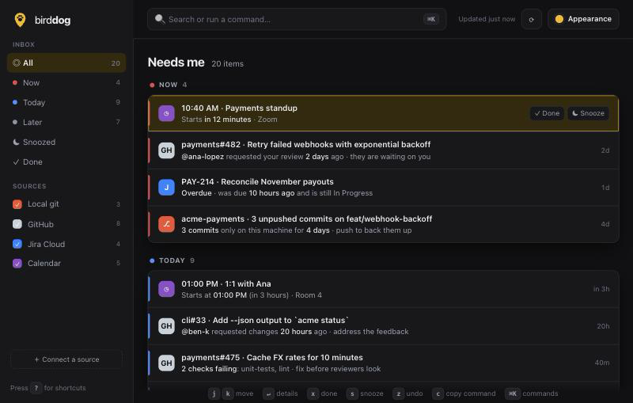

# 🐾 Birddog

**What needs me next?** Birddog is a local-first dashboard for developers. A bird dog finds what matters and points at it: Birddog sniffs through your work, ranks it with plain rules, and tells you *why* each thing is in your list.

<!-- Screenshot placeholder: add docs/screenshot.png and replace this comment with
     . A demo GIF comes in v0.4. -->
> 📸 *Screenshot coming soon.*

- **Local-first.** Runs on your machine, binds to `127.0.0.1`, stores everything in a JSON file you can read. No account, no cloud, no telemetry.
- **Explains itself.** Every item has a "why" line and names the rule that put it there. No mystery scores.
- **Keyboard-first.** `j`/`k` to move, `x` done, `s` snooze, `z` undo, `⌘K` for everything else.
- **Zero runtime dependencies.** Node 22+ and `git`. That's it.
- **Optional SSO.** Put Birddog behind your Google, Okta or Entra login when you run it somewhere shared.

> **Status: v0.1, milestone 1.** The local git source is live. GitHub, Jira Cloud and Calendar sources are on the way (they show as "coming soon" in setup).

## Quick start

```bash
npx bird-dog --open
```

Or from a clone:

```bash
git clone <this repo> birddog && cd birddog
node bin/birddog.mjs --open
```

On first run Birddog looks for your code in the usual places (`~/code`, `~/src`, `~/projects`, `~/Developer`, …) and falls back to the folder you ran it from. Change the folders any time in **Connect a source** (or press `⌘K` → "Connect a source").

```
birddog                 start on http://127.0.0.1:4747
birddog --open          start and open your browser
birddog --port 5000     use another port
birddog --host 0.0.0.0  listen beyond localhost (only with login turned on)
birddog secret set oidc-client-secret   store a secret in your keychain (reads stdin)
birddog --help
```

If the port is busy, Birddog tries the next one. If Birddog is already running, `birddog --open` just opens the existing one.

## What it finds (local git)

Birddog scans the folders you choose (3 levels deep, skipping `node_modules`, `vendor`, `dist` and friends) and reports:

| Item | Example "why" | Suggested next step (copy with `c`) |
|---|---|---|
| Unpushed commits | **3 commits** only on this machine for **5 days** · push to back them up | `git -C ~/code/api push -u origin feat/x` |
| Uncommitted changes | Edits sitting uncommitted for **4 days** · commit or stash before they get lost | `git -C ~/code/api status` |
| Merged branches | Already merged into **main** · safe to delete | `git -C ~/code/api branch -d old-a old-b` |
| Stale branches | No commits in **3 months** · finish, rebase or delete | `git -C ~/code/api branch -vv` |

It is read-only: it never fetches, commits, pushes or deletes. It only runs `git status`, `for-each-ref`, `log`, `branch --merged`, `symbolic-ref` and `remote`, each with a timeout and with `GIT_OPTIONAL_LOCKS=0` so it never fights your editor for the index lock.

## How ranking works

Rules live in [`src/rules.mjs`](src/rules.mjs). They are checked top to bottom and the first match wins:

| Rule | Urgency |
|---|---|
| Unpushed commits older than 3 days | **Now** |
| Unpushed commits older than 1 day | Today |
| Fresh unpushed commits | Later |
| Uncommitted edits older than 3 days | Today |
| Recent uncommitted edits | Later |
| Only untracked files | Later |
| Local branches already merged | Later |
| Unmerged branches with no commits for 30 days (or remote branch deleted) | Later |

Inside a group, items sort by rule order, then oldest first (the work that has waited longest is most at risk). A branch counts as either stale *or* unpushed, never both, and repos with no remote are never nagged about pushing.

## Triage

- **Done** (`x`) hides an item until it changes. New commits on that branch, or new files in that repo, bring it back.
- **Snooze** (`s`, then `1`–`4`): 1 hour, tomorrow 9:00, next Monday 9:00, or *until it changes*.
- **Undo** (`z`) after either. **Restore** (`u`) from the Done or Snoozed view.
- Decisions about items you have not seen for 30 days are forgotten.

All of it lives in `~/.config/birddog/state.json`, along with your theme.

## Keyboard

| Key | Action | Key | Action |
|---|---|---|---|
| `j` / `k` | move down / up | `↵` | open details |
| `x` | done | `s` | snooze |
| `z` | undo | `u` | restore |
| `c` | copy suggested command | `o` | open link |
| `r` | refresh | `/` or `⌘K` | command palette |
| `1`–`6` | All / Now / Today / Later / Snoozed / Done | `?` | shortcuts |
| `t` | light / dark | `p` | next theme |

## Themes

Three palettes, each in light, dark or system mode: **Retriever gold** (default), **Electric violet** and **Sunset**. Pick one from **Appearance**, or press `p` to cycle.

## Sign in with GitHub

GitHub items arrive in the next release, but you can connect now from **Connect a source**. You never paste a token:

- **Use my gh CLI login.** If you already ran `gh auth login`, Birddog asks `gh` for a token whenever it needs one and keeps no copy.
- **Sign in with GitHub** (device flow). Birddog shows a short code; you approve it on github.com. This needs a GitHub OAuth App client ID, because each install should use its own app:
  1. GitHub → Settings → Developer settings → OAuth Apps → **New OAuth App** (any homepage and callback URL, e.g. `http://127.0.0.1:4747`).
  2. Tick **Enable Device Flow**, save, and copy the **Client ID** (no secret needed).
  3. Add it to config.json: `"sources": { "github": { "clientId": "Ov23li…" } }` and restart.

  The token goes into your OS keychain. For GitHub Enterprise, also set `webUrl` and `apiUrl` there.

## Login for the dashboard (SSO)

Off by default: on `127.0.0.1` only you can reach Birddog. Turn it on when you run Birddog somewhere shared, such as a home server or a VM behind a reverse proxy. It works with any OpenID Connect provider: Google, Okta, Microsoft Entra ID, Auth0, Keycloak, Authentik, …

1. Register a **web application** with your provider. Redirect URI: `http://127.0.0.1:4747/auth/callback` (or `https://your-host/auth/callback` when you set `publicUrl`).
2. Add an `auth` block to config.json:

   ```json
   "auth": {
     "enabled": true,
     "issuer": "https://accounts.google.com",
     "clientId": "1234-abc.apps.googleusercontent.com",
     "allowedEmails": ["you@example.com"],
     "allowedDomains": ["yourteam.dev"],
     "publicUrl": "https://birddog.example.com"
   }
   ```

3. If your provider gives you a client secret, keep it out of config.json:

   ```bash
   pbpaste | birddog secret set oidc-client-secret
   ```

   (or set `BIRDDOG_OIDC_CLIENT_SECRET`). Then restart Birddog. With login on you may also listen beyond localhost, e.g. `birddog --host 0.0.0.0`.

How it behaves:

- Pages redirect to your provider, and API calls without a session get `401`. After sign-in you land back where you were.
- Authorization code flow with **PKCE**, `state` and `nonce`. The ID token's signature (RS256/PS256/ES256 families, from the provider's published keys), issuer, audience and expiry are all checked.
- **Allow list required.** Birddog refuses to start with login on unless `allowedEmails` or `allowedDomains` says who may sign in; otherwise anyone with a Google account could. Unverified emails are refused. Removing someone from the list locks them out on their next request.
- Sessions are signed, `HttpOnly`, `SameSite=Lax` cookies (`__Host-` and `Secure` over https), 7 days by default (`sessionDays`). The signing key lives in your OS keychain.
- `publicUrl` is also the only extra `Host` Birddog will answer to.

## Secrets

Tokens and keys go to the **macOS Keychain**, or **Secret Service** on Linux (via `secret-tool`), under the service name `birddog`. Elsewhere they fall back to `secrets.json` in the config folder with mode 600. The startup banner says which one is in use. Force one with `BIRDDOG_SECRETS=keychain|secret-service|file`.

## Configuration

`~/.config/birddog/config.json` (or `$XDG_CONFIG_HOME/birddog`, or `$BIRDDOG_HOME`):

```json
{
  "port": 4747,
  "refreshMinutes": 5,
  "sources": {
    "git": { "enabled": true, "roots": ["~/code"], "maxDepth": 3, "staleDays": 30 }
  }
}
```

Next to it: `state.json` (done/snooze/preferences), `cache.json` (last good data from each source) and `connections.json` (who you are signed in as; never tokens). Changes to `auth` take effect on restart.

## Writing a source

A source is an ES module in `src/sources/` that exports four things, then gets added to `SOURCES` in [`src/sources/index.mjs`](src/sources/index.mjs):

```js
export const id = 'weather';           // unique, used in item ids and config
export const name = 'Weather';         // shown in the UI

// Can this source work with this config? Shown in setup.
export async function test(config) {
  return { ok: true, message: 'Connected as @you' };
}

// Return what needs attention right now.
export async function collect(config, ctx) {
  // ctx.now      timestamp of this run
  // ctx.warn(s)  report a non-fatal problem
  return [{
    id: 'weather:umbrella',
    source: 'weather',
    kind: 'umbrella',
    title: 'Take an umbrella',
    url: 'https://example.com/forecast',  // http(s) or null
    why: 'Rain from **3 PM** · you have a walk at 4',
    urgency: 'today',                      // 'now' | 'today' | 'later'
    updatedAt: new Date().toISOString(),
    meta: {
      fields: { Chance: '80%' },          // shown in the details drawer
      command: 'open https://example.com',// optional "next step" with a copy button
      fingerprint: 'rain-3pm',            // when this changes, done/snoozed items come back
    },
  }];
}
```

Optionally export `description` (a sentence for setup) and `normalizeSettings(input)` (validates what the setup screen may change).

The rules of the road:

- **Throw when you can't collect.** Birddog keeps your last good items, marks them stale with a timestamp, and shows the error with a "Fix in setup" link. One broken source never empties the inbox.
- **Items are validated.** A bad urgency or a non-http URL fails the run instead of rendering junk.
- **Keep `why` short and specific.** It is the most important line in the app. `**bold**` is the only markup.
- **Rank with rules** from `src/rules.mjs`, so the drawer can say which rule fired.
- Each run has a 60 second timeout.

## API

The UI talks to a small JSON API on the same port. It answers only on `localhost`/`127.0.0.1` (plus `auth.publicUrl` when login is on), rejects foreign `Host` and `Origin` headers, and only accepts JSON writes, so other websites cannot read or change your data.

| Method | Path | |
|---|---|---|
| `GET` | `/api/items` | items (with `status`: open/done/snoozed) and per-source status |
| `POST` | `/api/refresh` | re-run all sources |
| `POST` | `/api/items/:id/done` | mark done |
| `POST` | `/api/items/:id/snooze` | `{ "until": "<ISO date>" \| "change" }` |
| `POST` | `/api/items/:id/restore` | undo done/snooze |
| `GET`/`PUT` | `/api/prefs` | theme, mode, hidden sources |
| `GET` | `/api/setup` | sources and their settings |
| `POST` | `/api/sources/:id/test` | try settings without saving |
| `PUT` | `/api/sources/:id` | save settings and rescan |
| `GET` | `/api/me` | whether login is on, and who is signed in |
| `GET` / `DELETE` | `/api/connections/github` | GitHub sign-in status / disconnect |
| `POST` | `/api/connections/github/device` | start "Sign in with GitHub" |
| `POST` | `/api/connections/github/gh-cli` | connect using the gh CLI login |
| `GET` | `/auth/login`, `/auth/callback` | SSO sign-in (when login is on) |
| `POST` | `/auth/logout` | sign out |

## Development

```bash
npm test          # node:test, no dependencies; builds throwaway git repos in your temp folder
npm run dev       # start and open the browser
```

Layout:

```
bin/birddog.mjs        CLI
src/items.mjs          the Item model and sort order
src/rules.mjs          ranking rules and "why" text
src/collector.mjs      runs sources, keeps last good data, marks stale
src/triage.mjs         done / snooze / prefs (state.json)
src/server.mjs         HTTP server, API and login gate
src/secrets.mjs        OS keychain / Secret Service / file secret store
src/auth/oidc.mjs      OpenID Connect sign-in (PKCE, ID token checks)
src/auth/session.mjs   signed session cookies
src/auth/github.mjs    GitHub device flow and gh CLI sign-in
src/sources/git.mjs    local git source
public/                the UI: plain HTML, CSS and ES modules, no build step
test/                  node:test suites
```

## Roadmap

1. ✅ Skeleton, local git source, real UI, optional SSO, GitHub sign-in, OS keychain secrets
2. GitHub and Jira Cloud sources
3. Setup wizard for the remaining sources, calendar (iCal) source
4. Read-only MCP server so your AI tools can ask "what needs me?", demo GIF, npm release

## License

[MIT](LICENSE) © Marcus Ferrell
